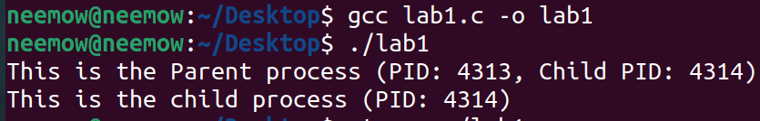
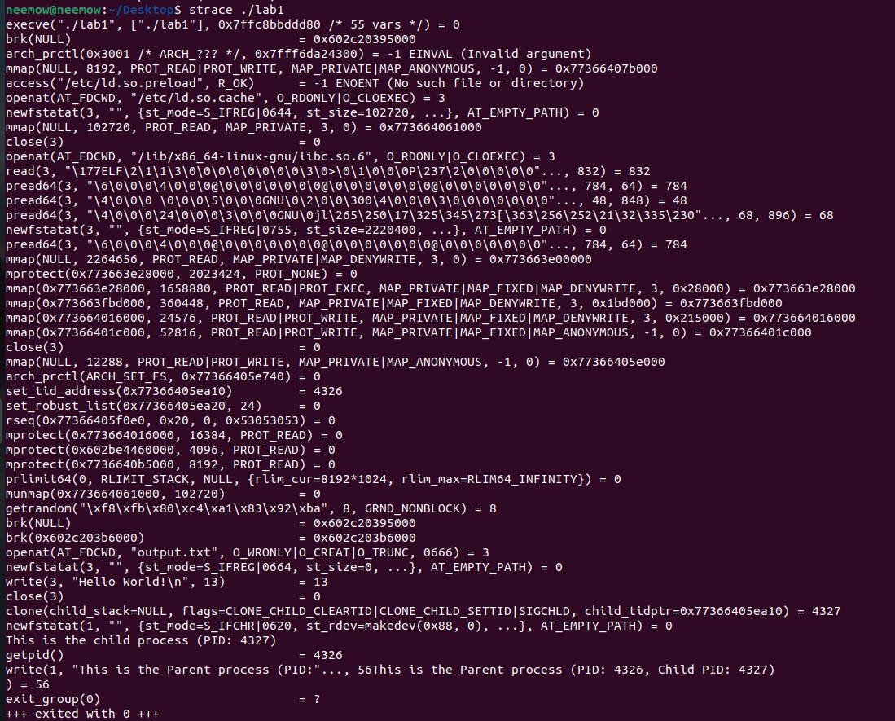
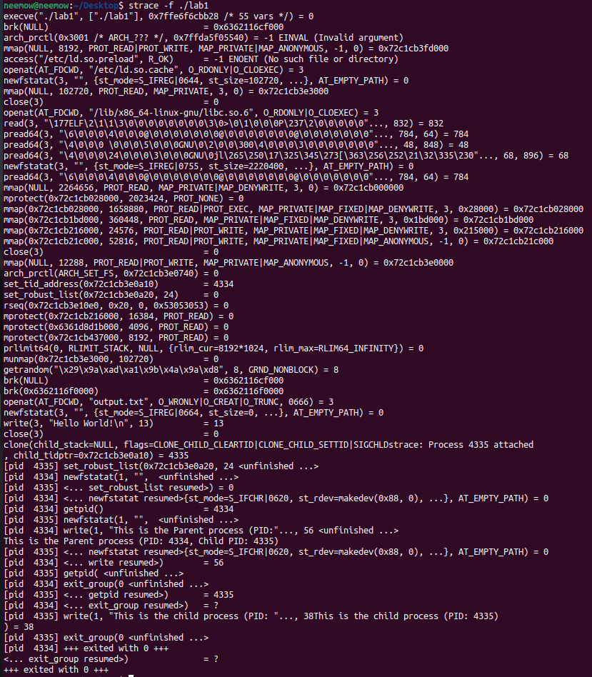

# LAB1 REPORT

## Compiling and Running the Program

The goal of this lab is to compile a simple C program and investigate its system calls using `strace`.

The program performs three main operations:

1. Creates `output.txt` and writes `Hello World!` into it.
2. Calls `fork()` to create a child process.
3. Both the parent and child processes print their messages along with their PIDs.

I compiled and ran the program using the following commands:

```bash
gcc lab1.c -o lab1
./lab1
```



As shown in the output, both the parent and child processes execute successfully and print their respective process IDs.

---

## Tracing with strace

To trace the system calls made by the program, I used:

```bash
strace ./lab1
```



The output shows several system calls performed during program execution.

Some important observations:

- `execve()` loads and starts the program.
- `openat()` creates or opens `output.txt`.
- `write()` writes `Hello World!` into the file.
- `close()` closes the file.
- `clone()` creates the child process when `fork()` is called.
- `getpid()` retrieves the process ID.
- `write()` prints the messages to the terminal.
- `exit_group()` terminates the process.

There are also several system calls related to program loading, memory allocation, and library initialization.

**An important observation:** Without the `-f` option, `strace` only traces the parent process. Although the child process prints its message in the terminal, its system calls are not included in the trace.

---

## Tracing with strace -f

To trace both the parent and child processes, I used the `-f` option:

```bash
strace -f ./lab1
```



Unlike the previous command, this time `strace` follows the child process created by `fork()`.

The output shows the following:

- `clone()` creates the child process.
- `strace` attaches to the child process automatically.
- Each system call is displayed with its corresponding PID.
- Both processes execute `getpid()` and `write()`.
- Both processes terminate using `exit_group()`.

This allows us to observe the system calls of both processes and see how they execute concurrently.

---

## Comparison: strace vs strace -f

The main difference between these two commands is whether child processes are traced.

| Feature | `strace` | `strace -f` |
|---|---|---|
| Parent process | Traced | Traced |
| Child process | Not traced | Traced |
| Child system calls | Not visible | Visible |
| Process IDs | Not displayed as prefixes | Displayed for each process |
| `write()` calls | Only parent | Both parent and child |
| `exit_group()` calls | One | Two |

As a result, `strace -f` provides a more complete view of the program's execution when multiple processes are involved.

---

## Conclusion

In this lab, I used `strace` to investigate the system calls of a simple C program.

The results showed that:

- Library functions such as `fopen()`, `fclose()`, `fork()`, and `printf()` trigger underlying system calls.
- `fork()` is implemented through the `clone()` system call in this execution.
- `strace` only traces the parent process by default.
- Using `strace -f` allows us to follow child processes and observe their system calls as well.

Therefore, the `-f` option is useful when analyzing programs that create multiple processes.