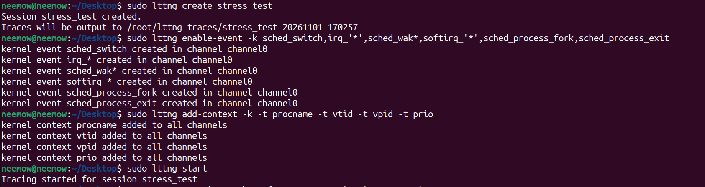
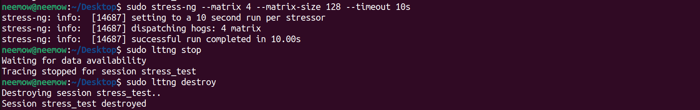
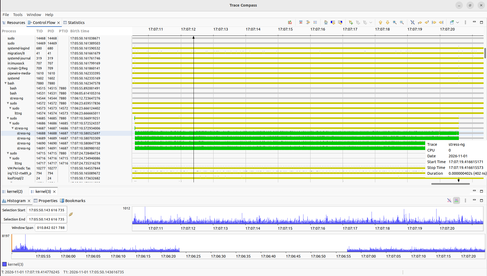
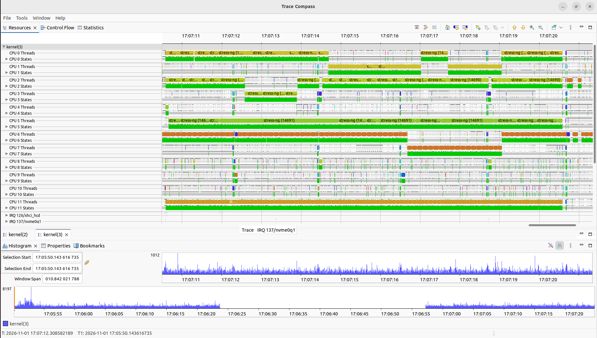
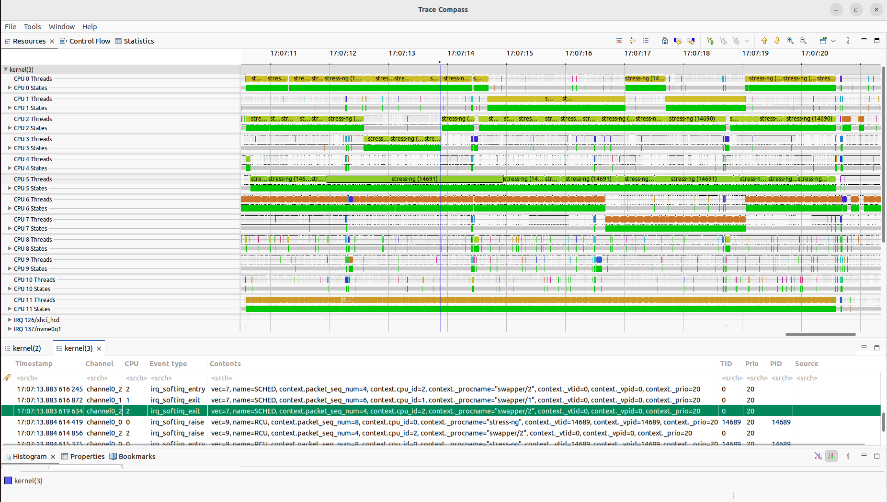

# LAB REPORT: Tracing the Linux Scheduler with LTTng and Trace Compass

## Tracing Setup

The goal of this lab is to investigate the Linux scheduler using **LTTng** and analyze the recorded events with **Trace Compass**.

I enabled the required kernel events and added the requested contexts using the following commands:

```bash
sudo lttng create stress_test

sudo lttng enable-event -k sched_switch,irq_*,sched_wak*,softirq_*,sched_process_fork,sched_process_exit

sudo lttng add-context -k -t procname -t vtid -t vpid -t prio

sudo lttng start
```



The selected events include:

- `sched_switch`: Records context switches between tasks.
- `sched_wak*`: Records task wake-up events.
- `irq_*` and `softirq_*`: Records hardware and software interrupts.
- `sched_process_fork`: Records process/thread creation.
- `sched_process_exit`: Records process/thread termination.

The following contexts were also added: `procname`, `vtid`, `vpid`, and `prio`.

---

## Running the Workload

To generate CPU activity, I used `stress-ng` with four matrix workers:

```bash
sudo stress-ng --matrix 4 --matrix-size 128 --timeout 10s

sudo lttng stop
sudo lttng destroy
```



The command starts four workers performing matrix operations for 10 seconds. After the execution, I stopped the tracing session and imported the resulting trace into Trace Compass.

---

## Analysis in Trace Compass

### 1. Control Flow View

The Control Flow view shows the execution states of processes and threads over time.



The main observations are:

- The `stress-ng` parent process creates four worker threads.
- All four workers are active for almost the entire 10-second test.
- The workers spend most of their time in user mode, performing CPU-intensive calculations.
- The parent process and `sudo` processes remain mostly blocked while waiting for the workers.
- Background processes occasionally wake up and execute for short periods.

This confirms that the matrix workers are CPU-bound tasks.

### 2. Resources View

The Resources view shows how different CPUs are used during the workload.



The main observations are:

- The four workers execute across multiple CPUs.
- Several CPUs remain mostly idle during the test.
- Some workers migrate between CPUs. For example, a thread moves between CPU 6 and CPU 7.
- Short interruptions caused by interrupts and background tasks can also be observed.
- The busy CPUs remain mostly in user mode during the workload.

This shows how the scheduler distributes CPU-bound tasks across available processors.

### 3. Event Table

The event table provides access to the recorded events and their associated contexts.



Some observed events include:

- `irq_softirq_entry` and `irq_softirq_exit`: Show software interrupt execution.
- `irq_softirq_raise`: Shows when a software interrupt is raised.
- `sched_switch`: Records context switches between tasks.

The added context fields are also visible in the event table, including process name, process ID, thread ID, and priority.

The observed tasks have a priority value of `20`, corresponding to the default priority of normal tasks.

---

## Conclusion

In this lab, I used LTTng to record Linux scheduler events and Trace Compass to analyze the results.

The observations showed that:

- Four CPU-bound workers were created by `stress-ng` and executed in parallel across different CPUs.
- The parent process mostly waited for the workers to finish.
- The scheduler distributed tasks across CPUs and occasionally migrated threads between them.
- Interrupts and background processes caused short interruptions during execution.
- Trace Compass provided useful views for investigating thread states, CPU usage, and recorded events.

Overall, this experiment demonstrated how LTTng and Trace Compass can be used to investigate Linux scheduler behavior and understand how processes and threads are managed by the operating system.