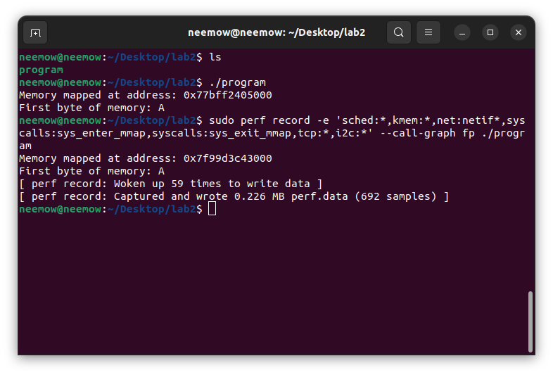
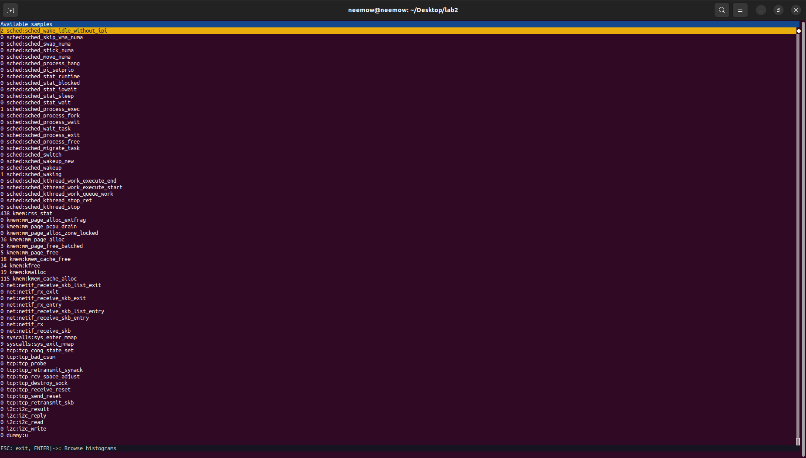
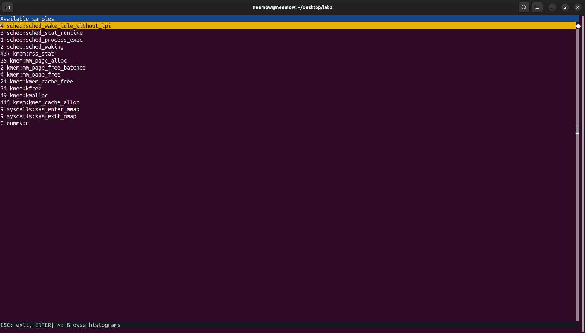
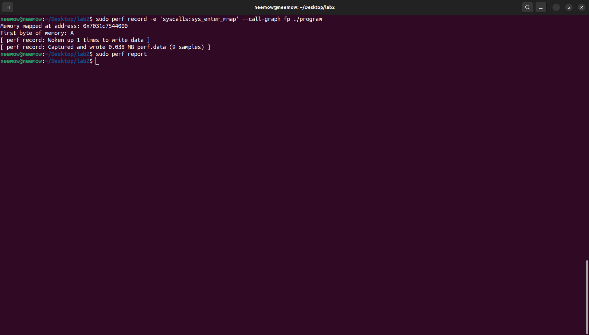
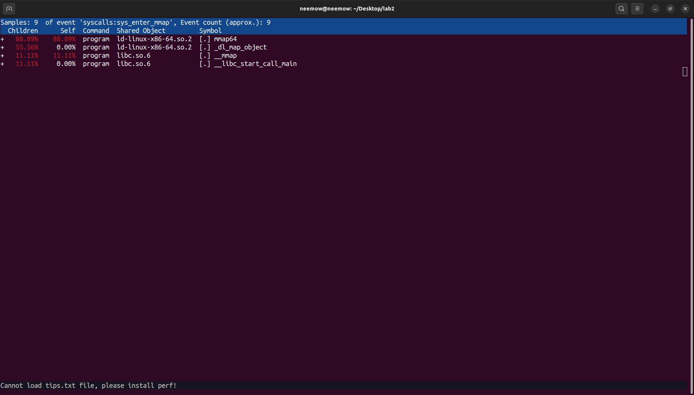
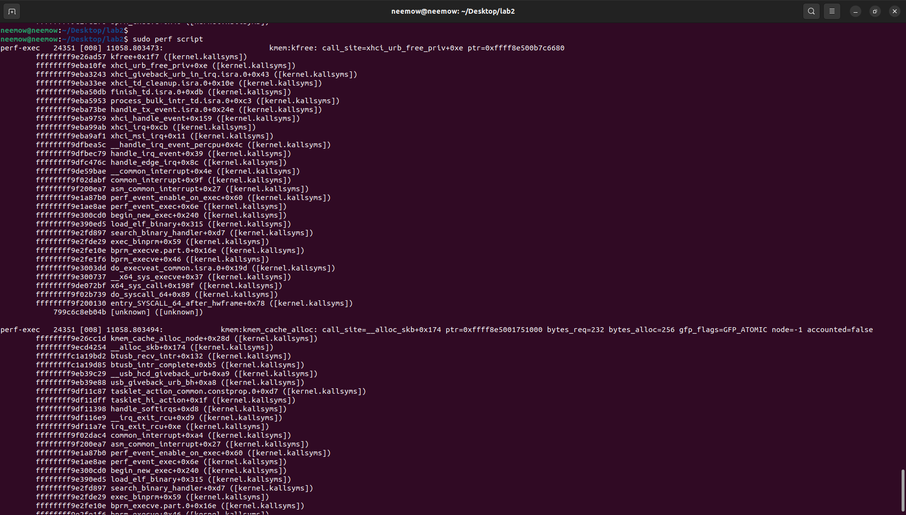
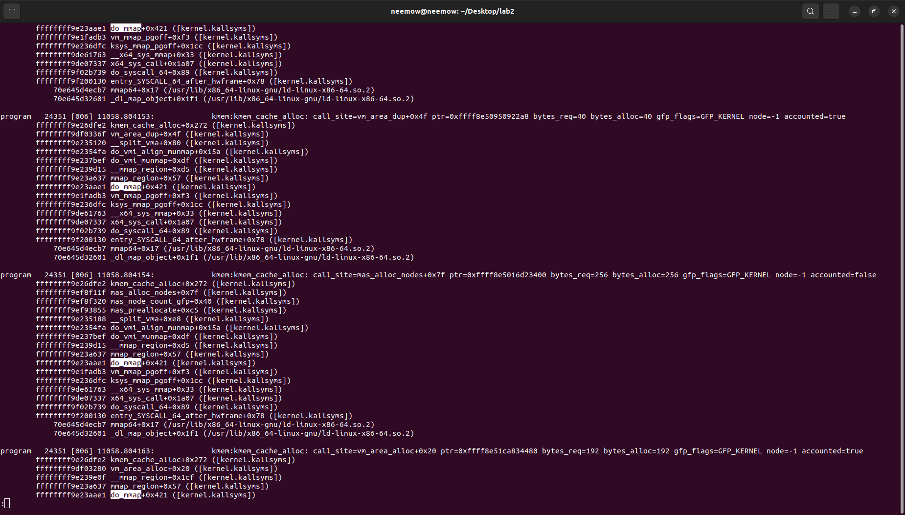
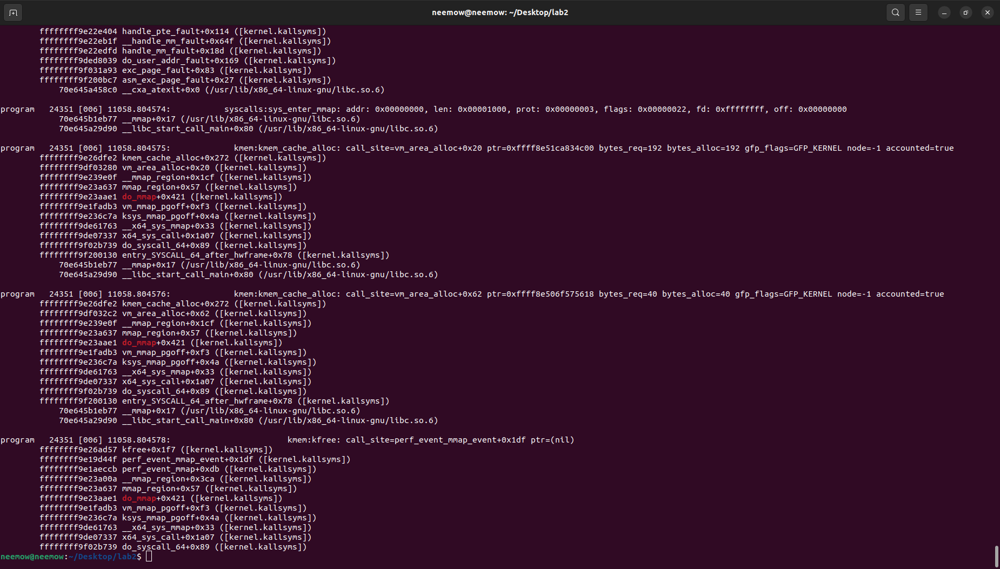
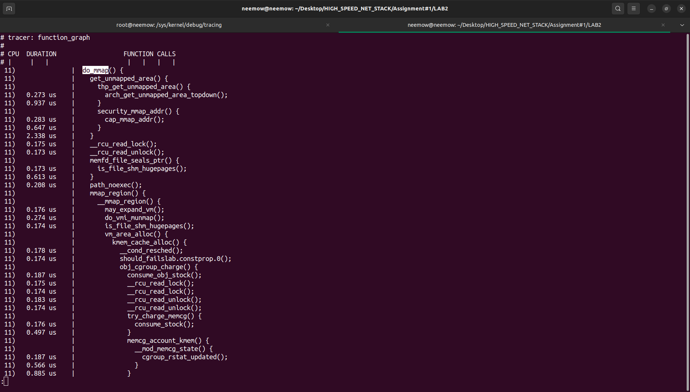
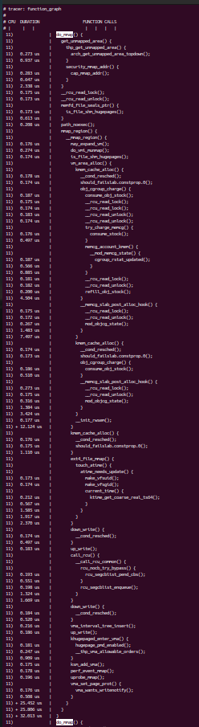

### LAB2 REPORT

I ran the command based on the instructions.



**Command:**
```bash
sudo perf record -e 'sched:*,kmem:*,net:netif*,syscalls:sys_enter_mmap,syscalls:sys_exit_mmap,tcp:*,i2c:*' --call-graph fp ./program
```

To view the results and the events raised by the program, I used the `sudo perf report` command. Here is the result.



As you can see, some events have the number 0 next to them, meaning that no occurrences of those events were recorded while the program was running (such as `tcp:*`, `net:netif*` and `i2c:*`).
So, for tracking the appropriate events, we should focus on the events that were actually triggered during the program's execution and had nonzero counts.


### Tracking the appropriate events

Using the command below, I trimmed the events with 0 occurrences to get a better look:

```bash
sudo perf record -e 'sched:sched_wake_idle_without_ipi,sched:sched_stat_runtime,sched:sched_process_exec,sched:sched_waking,kmem:rss_stat,kmem:mm_page_alloc,kmem:mm_page_free_batched,kmem:mm_page_free,kmem:kmem_cache_free,kmem:kfree,kmem:kmalloc,kmem:kmem_cache_alloc,syscalls:sys_enter_mmap,syscalls:sys_exit_mmap' --call-graph fp ./program
```



As another example, here is the `sys_enter_mmap` event. First, the command I wrote:



And here is the output of `sudo perf report` on this particular event:



This is also the output of `sudo perf script` for viewing the stack of instructions that the program ran:




### do_mmap function and its call stack

To find the `do_mmap` function and examine its call stack, I used the following command:

```bash
sudo perf script | grep -B 20 -A 5 'do_mmap'
```

Using this command, I found several occurrences of `do_mmap` and examined their call stacks.



One of the recorded stacks shows that the program calls `mmap` through the libc `__mmap` function. The request then enters the kernel through `entry_SYSCALL_64_after_hwframe` and passes through `do_syscall_64`, `__x64_sys_mmap`, `ksys_mmap_pgoff`, and `vm_mmap_pgoff` until it reaches `do_mmap`.



The `do_mmap` function handles the requested memory mapping. It processes the mapping parameters and continues through `mmap_region` and `__mmap_region` to set up the memory region.

During this process, `vm_area_alloc` allocates a VMA (Virtual Memory Area) structure using `kmem_cache_alloc`.

In this particular example, the program requested a 4 KB private, anonymous memory region with read and write permissions (`MAP_PRIVATE | MAP_ANONYMOUS`). This demonstrates how a userspace memory mapping request is handled by the Linux kernel and how kernel memory is allocated to manage the mapping.


### Tracing nested functions of do_mmap using ftrace

For this part, I used `ftrace` to enable the same events discovered in the previous part and trace the program. I used the `function_graph` tracer to examine the nested functions called by `do_mmap`.

I configured the tracer using a Bash script provided in this folder as `trace_lab2.sh`, enabling the previously identified scheduler, memory management, and mmap syscall events. I also used `set_graph_function` to focus the function graph on `do_mmap` and its nested functions.

After running the program, I viewed the results using:

```bash
sudo cat /sys/kernel/debug/tracing/trace | less
```

The output shows the nested function calls inside `do_mmap`, including their execution hierarchy and duration.



This output continues further. By using `/do_mmap` to search for these function calls, I was able to find the complete function graph:



Based on the output, the mapping process can be divided into several steps:

1. **Finding a suitable address:** `get_unmapped_area()` is called to find an available virtual address range. It uses functions such as `thp_get_unmapped_area()` and `arch_get_unmapped_area_topdown()`.

2. **Security and mapping checks:** Functions such as `security_mmap_addr()`, `cap_mmap_addr()`, `memfd_file_seals_ptr()` and `path_noexec()` perform different checks related to the requested mapping.

3. **Setting up the memory region:** `mmap_region()` and `__mmap_region()` handle the creation and configuration of the memory region. `may_expand_vm()` checks whether the process can expand its virtual memory usage, while `do_vmi_munmap()` handles the removal of overlapping mappings when necessary.

4. **Allocating memory structures:** `vm_area_alloc()` allocates the VMA (Virtual Memory Area) structure using `kmem_cache_alloc()`. Additional functions such as `obj_cgroup_charge()` and `memcg_account_kmem()` handle kernel memory accounting.

5. **Finalizing the mapping:** The kernel performs additional operations, including inserting the VMA into the interval tree, handling Transparent Huge Pages through `khugepaged_enter_vma()`, and notifying subsystems such as `perf_event_mmap()` and `uprobe_mmap()`.

The function graph shows that `do_mmap` does more than simply allocate memory. It finds a suitable virtual address, performs security and mapping checks, creates the memory region, allocates the required kernel structures, and updates the related memory management structures.

In this execution, the complete `do_mmap()` operation took approximately **32.013 microseconds**, according to the ftrace output.
