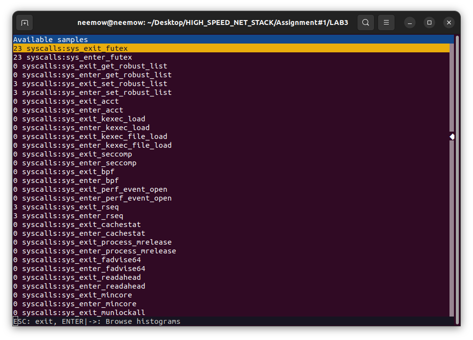
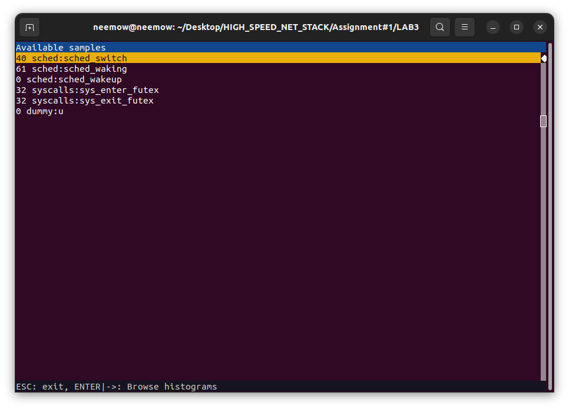
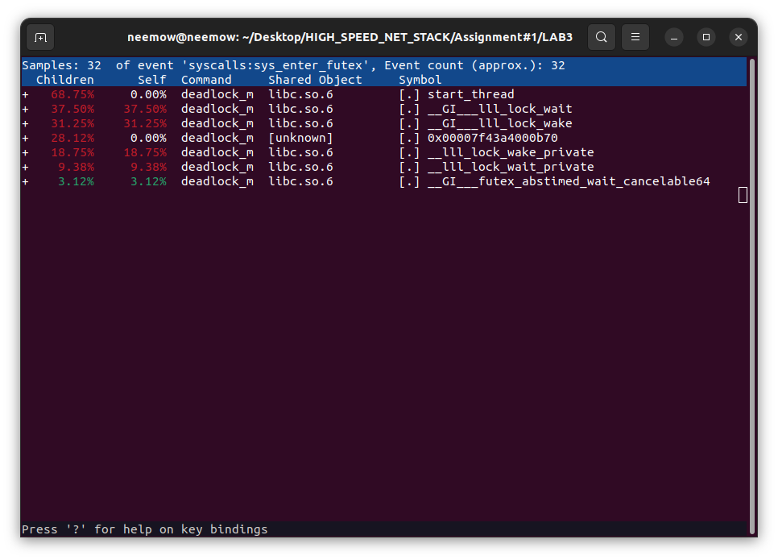
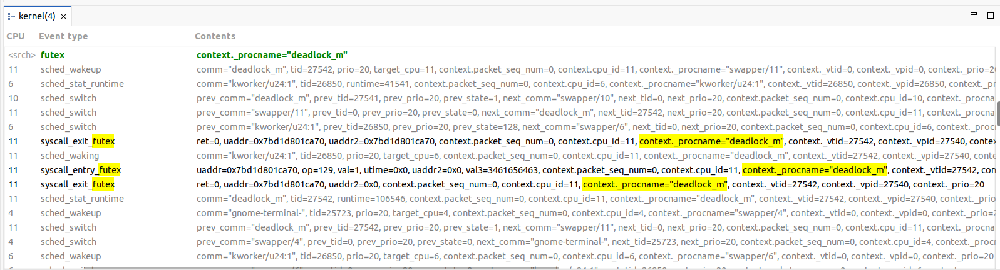
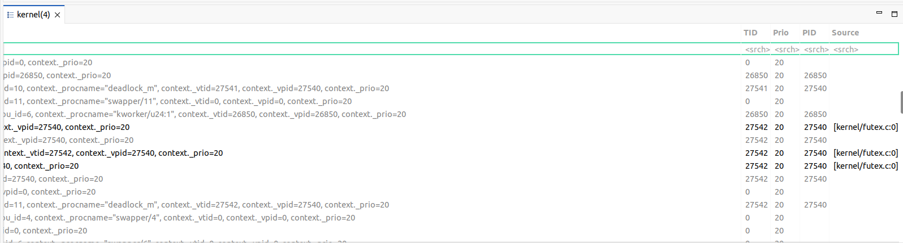
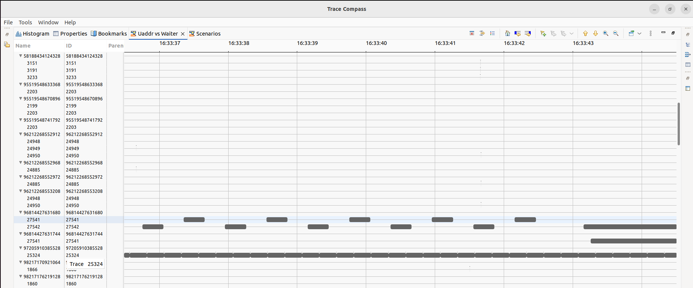

# LAB 3 REPORT

## 1. Running the program and observing its behavior

I ran the `deadlock_m` program and here is the output:

```text
Thread 1: Waiting for A
Thread 1: Locked A
Thread 2: Waiting for B
Thread 2: Locked B
Thread 2: Unlocked B
Thread 2: Waiting for A
Thread 1: Unlocked A
Thread 1: Waiting for B
Thread 1: Locked B
Thread 2: Locked A
Thread 1: Unlocked B
Thread 1: Waiting for A
Thread 2: Unlocked A
Thread 2: Waiting for B
Thread 2: Locked B
Thread 1: Locked A
Thread 2: Unlocked B
Thread 2: Waiting for A
Thread 1: Unlocked A
Thread 1: Waiting for B
Thread 1: Locked B
Thread 2: Locked A
Thread 1: Unlocked B
Thread 1: Waiting for A
Thread 2: Unlocked A
Thread 2: Waiting for B
Thread 2: Locked B
Thread 1: Locked A
Thread 2: Unlocked B
Thread 2: Waiting for A
Thread 1: Unlocked A
Thread 1: Waiting for B
Thread 1: Locked B
Thread 2: Locked A
Thread 1: Unlocked B
Thread 1: Waiting for A
Thread 2: Unlocked A
Thread 2: Waiting for B
Thread 2: Locked B
Thread 1: Locked A
Thread 2: Unlocked B
Thread 2: Waiting for A
Thread 1: Unlocked A
Thread 1: Waiting for B
Thread 1: Locked B
Thread 2: Locked A
Thread 1: Unlocked B
Thread 1: Waiting for A
Thread 2: Unlocked A
Thread 2: Waiting for B
Thread 2: Locked B
Thread 1: Locked A
Thread 2: Unlocked B
Thread 2: Waiting for A
Thread 1: Unlocked A
Thread 1: Waiting for B
Thread 1: Locked B
Thread 2: Locked A
Thread 1: Unlocked B
Thread 1: Waiting for A
Thread 2: Unlocked A
Thread 2: Waiting for B
Thread 2: Locked B
Thread 1: Locked A
Thread 2: Waiting for A
Thread 1: Waiting for B
```

### Observation

It looks like the program uses two threads (Thread 1 and Thread 2) that compete for access to two mutex locks, A and B.

Each thread locks and unlocks these resources in a different order. Thread 1 first acquires A and then tries to acquire B, while Thread 2 first acquires B and then tries to acquire A and so on.

If the ordering of unlocking and acquiring the locks is okay, the program continues to run. But at the end of the output, this happens:

```text
Thread 2: Locked B
Thread 1: Locked A
Thread 2: Waiting for A
Thread 1: Waiting for B
```

This suggests that a deadlock has occurred: Thread 2 is waiting for A, which is held by Thread 1, while Thread 1 is waiting for B, which is held by Thread 2.

Neither thread can proceed, so the program gets stuck.

## 2. Identifying the system calls using perf

To investigate which kernel events are triggered by the program, I used `perf record` to record scheduler and syscall events:

```bash
sudo perf record -e 'sched:*,syscalls:*' --call-graph fp ./deadlock_m
```


Then, I used the following command to view the recorded events:

```bash
sudo perf report
```



After examining the results, I found the following events:

| Event | Recorded samples |
|---|---:|
| `sched:sched_switch` | 40 |
| `sched:sched_waking` | 61 |
| `sched:sched_wakeup` | 0 |
| `syscalls:sys_enter_futex` | 32 |
| `syscalls:sys_exit_futex` | 32 |

Based on these results, I focused on the events with nonzero counts and recorded them separately:

```bash
sudo perf record -e 'sched:sched_switch,sched:sched_waking,syscalls:sys_enter_futex,syscalls:sys_exit_futex' --call-graph fp ./deadlock_m
```



This allowed me to focus on the scheduler activity and the futex system calls without including events that had zero recorded occurrences.

## 3. Investigating the futex system call

The most interesting events in the results were:

- `syscalls:sys_enter_futex`
- `syscalls:sys_exit_futex`

Both events had 32 recorded samples.

These events indicate when the program enters and exits the Linux `futex` system call.

To examine the functions associated with `sys_enter_futex`, I opened its entry in `perf report`.
sys_enter_futex



The `sys_enter_futex` event shows when a thread enters the kernel to perform this synchronization operation, while `sys_exit_futex` shows when the system call returns.

### Conclusion

Based on the program's behavior and the `perf` results, the **`futex` system call** is the main system call to investigate in the next part of the assignment.

The program uses pthread mutexes, and Linux commonly implements their blocking and waking mechanisms using futexes. The recorded futex events and the associated glibc functions provide evidence of this synchronization activity.

Therefore, I will use **LTTng** to trace the futex system calls and **Trace Compass** to analyze the resulting trace and investigate the threads' synchronization behavior.

## 4. Tracing with LTTng and analyzing with Trace Compass

After identifying futex as the relevant system call, I used LTTng to trace futex system calls and scheduler events.

I created a tracing session and enabled the required events:

```bash
sudo lttng create deadlock_futex_trace

sudo lttng enable-event -k 'sched_*'
sudo lttng enable-event -k --syscall futex

sudo lttng add-context -k -t procname -t vtid -t vpid -t prio

sudo lttng start
```

I then ran the program:

```bash
./deadlock_m
```

After collecting the events, I stopped the tracing session:

```bash
sudo lttng stop
sudo lttng destroy
```

I imported the resulting trace into Trace Compass and searched for futex events associated with `deadlock_m`.



From the event information, I identified the process and its threads:

| Identifier | Value |
|---|---:|
| Process name | `deadlock_m` |
| Process ID (PID) | `27540` |
| Main thread TID | `27540` |
| Thread 1 TID | `27541` |
| Thread 2 TID | `27542` |

## 5. Analyzing the Uaddr vs Waiter view

Next, I opened **Uaddr vs Waiter** under **Futex Contention Analysis** in Trace Compass.

I located the two worker threads using their TIDs, `27541` and `27542`.



After identifying the threads, I zoomed out to observe their futex waiting behavior over time.



### Observation

The graph shows repeated futex waiting intervals for both worker threads. Most of these intervals are relatively short, which is consistent with the program repeatedly acquiring and releasing its mutexes.

Toward the end of the trace, the waiting intervals become much longer. Both threads remain blocked instead of continuing their previous execution pattern.

This matches the final output of the program: Thread 1 is waiting for B while Thread 2 is waiting for A.

The graph therefore provides further evidence of the deadlock. Both threads are waiting on mutex-related futex operations and cannot make progress.

## 6. Conclusion

The investigation showed that the **futex system call** is the key system call involved in this program's synchronization behavior.

Using `perf`, I identified futex entry and exit events alongside scheduler activity. I then used LTTng to collect these events and Trace Compass to examine the behavior of the two worker threads.

The `Uaddr vs Waiter` view showed repeated waiting intervals followed by long periods of waiting at the end of the trace.

Combining these observations with the program output, we can conclude that the program eventually enters a deadlock because its two threads acquire mutexes in opposite orders and end up waiting for each other indefinitely.