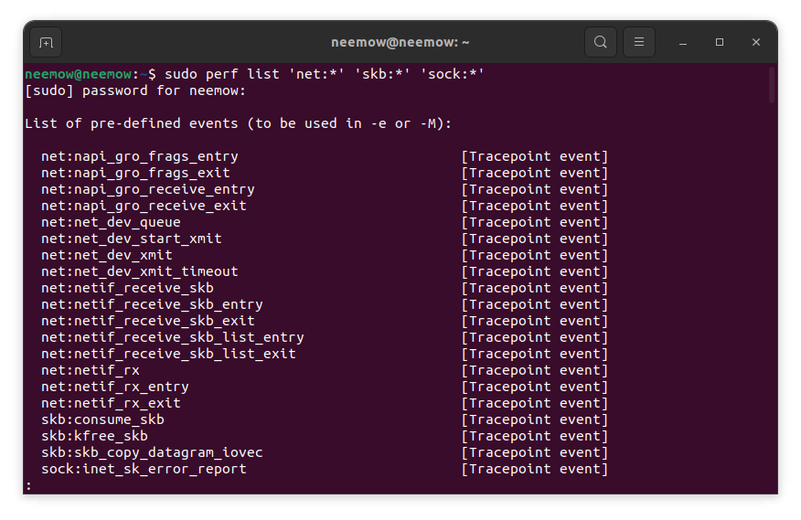
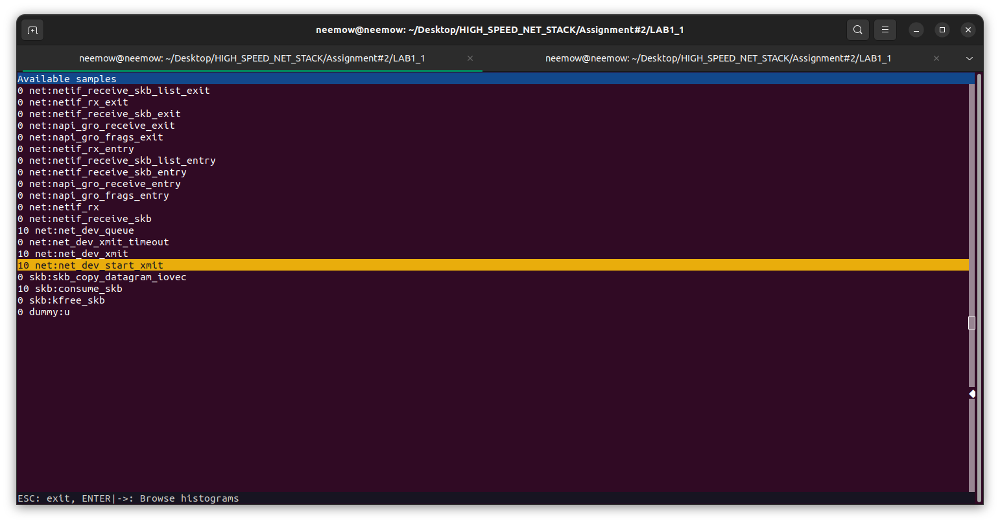
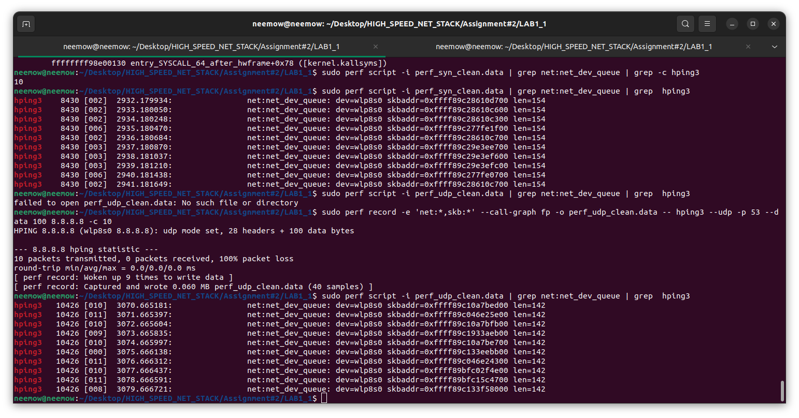
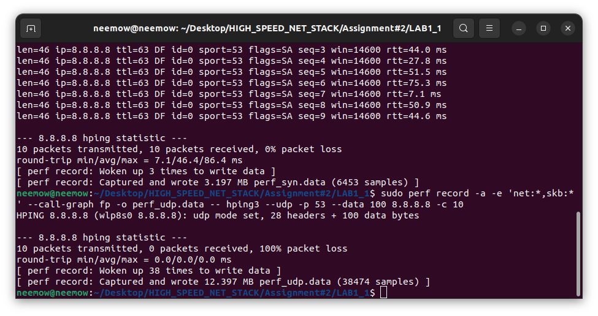
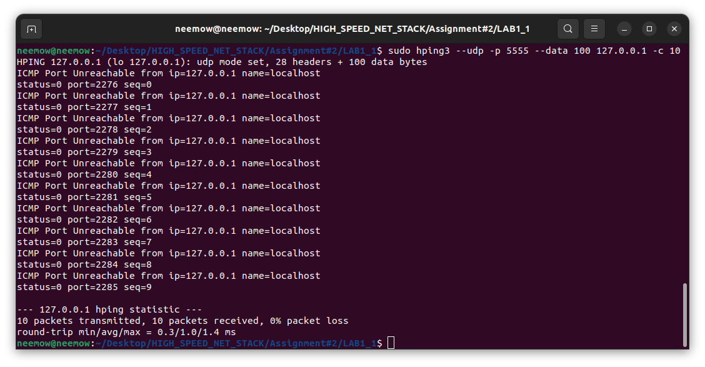
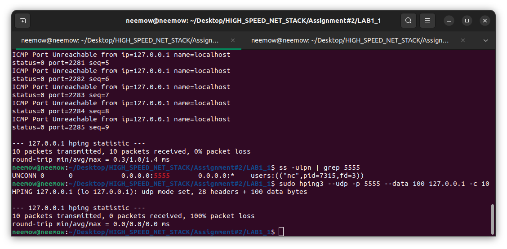
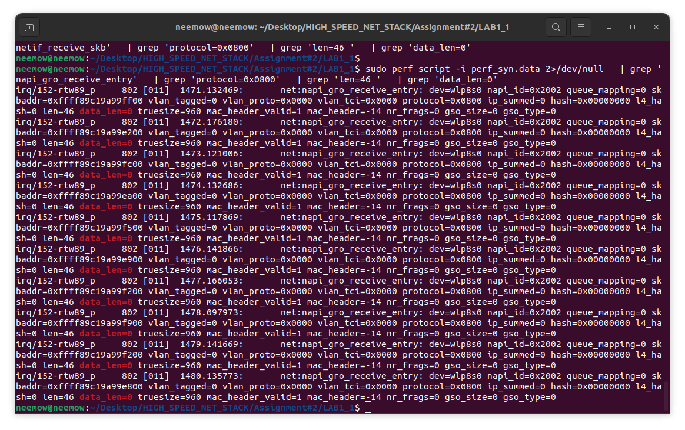
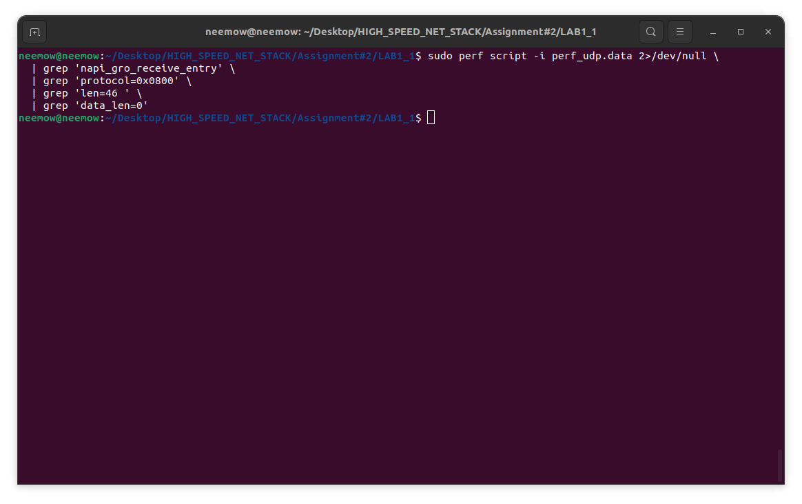
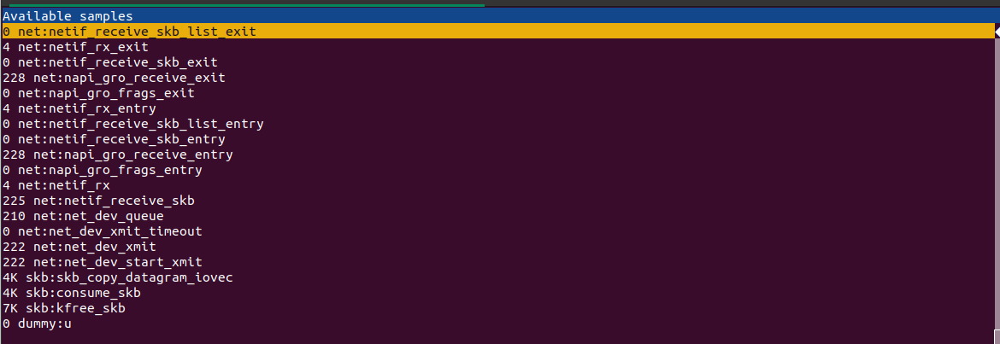
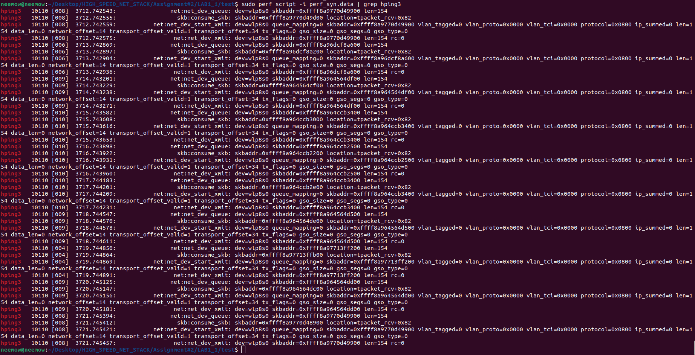

# Assignment 2 — Lab 1: Tracing TCP SYN and UDP Scans with `perf`

**Course:** High Speed Network Stack · **Host:** Ubuntu laptop, wireless interface `wlp8s0`
**Target:** `8.8.8.8:53` · **Tool:** `perf record -e 'net:*,skb:*'` · **Scanner:** `hping3`

---

## 1. Objective

Observe, at the kernel tracepoint level, how two different scan techniques are handled by the local Linux networking stack. The same target, port and payload are used for both, so that every observable difference can be attributed to the transport protocol and not to the traffic shape.

| Parameter | Value |
|---|---|
| Target / port | `8.8.8.8` : `53` (both scans) |
| Payload | 100 bytes (`--data 100`) |
| Probes per session | 10 (`-c 10`) |
| Events traced | `net:*`, `skb:*` |
| Call graph | `--call-graph fp` |

---

## 2. The two scan techniques

**TCP SYN scan (`-S`)** — half-open. Only a SYN segment is sent; a SYN-ACK reply means the port is open, an RST means closed. The handshake is never completed, so no connection is established on either side.

**UDP scan (`--udp`)** — stateless. UDP has no handshake, so an open port usually replies with nothing at all, while a closed port returns an ICMP *port unreachable*. Silence is therefore ambiguous: it means *open or filtered*.

The point of the lab is that both are simple to describe at the protocol level, yet they differ in what they force the kernel to do — and that difference should be visible in the trace.

---

## 3. Identifying the relevant tracepoints

The network-related tracepoints actually sampled in the capture were listed before any comparison was attempted:

- `net:net_dev_queue` — packet handed to the qdisc (before transmission)
- `net:net_dev_start_xmit` — driver hand-off (driver entry point)
- `net:net_dev_xmit` — driver returned, with `rc`
- `skb:consume_skb` / `skb:kfree_skb` — buffer released (success path / drop path)
- `net:napi_gro_receive_entry` / `_exit` — receive side



---

## 4. Recording the sessions

```bash
# system-wide capture, both scans
sudo perf record -a -e 'net:*,skb:*' --call-graph fp -o perf_syn.data -- \
     sudo hping3 -S -p 53 --data 100 8.8.8.8 -c 10

sudo perf record -a -e 'net:*,skb:*' --call-graph fp -o perf_udp.data -- \
     sudo hping3 --udp -p 53 --data 100 8.8.8.8 -c 10
```

The `-a` captures are large (SYN session: 6.031 MB, 17,851 samples) and dominated by background traffic: roughly 4,000 `napi_gro_receive` and 7,000 `skb:kfree_skb` samples, against only 40 events belonging to the ten probes. The noise made per-packet attribution unreliable, so the measurement was repeated **task-scoped**, dropping `-a`:

```bash
sudo perf record -e 'net:*,skb:*' --call-graph fp -o perf_syn_clean.data -- \
     sudo hping3 -S -p 53 --data 100 8.8.8.8 -c 10
```

Both clean files are the basis of the quantitative comparison below. Each contains exactly **40 samples = 10 packets × 4 events**, and `perf report --sort comm` attributes 100 % of them to `hping3`.





---

## 5. Event selected for comparison: `net:net_dev_start_xmit`

Out of the four events present in every probe, `net:net_dev_start_xmit` was chosen because it is the **lowest layer both scans reach through identical code**, it fires in the scanning task's own context (so it survives task-scoped recording), and it exposes the most information per packet: 14 fields covering L2 metadata, length, offsets and offload/queue state.

```bash
sudo perf script -i perf_syn_clean.data | grep 'net:net_dev_start_xmit' | grep hping3 > syn_xmit.txt
sudo perf script -i perf_udp_clean.data | grep 'net:net_dev_start_xmit' | grep hping3 > udp_xmit.txt
```

A representative record from each:

```text
hping3 8430 [002] 2932.179944: net:net_dev_start_xmit: dev=wlp8s0 queue_mapping=0
  skbaddr=0xffff89c28610d700 vlan_tagged=0 vlan_proto=0x0000 vlan_tci=0x0000
  protocol=0x0800 ip_summed=0 len=154 data_len=0 network_offset=14
  transport_offset_valid=1 transport_offset=34 tx_flags=0 gso_size=0 gso_segs=0 gso_type=0

hping3 10426 [010] 3070.665198: net:net_dev_start_xmit: dev=wlp8s0 queue_mapping=0
  skbaddr=0xffff89c10a7bed00 vlan_tagged=0 vlan_proto=0x0000 vlan_tci=0x0000
  protocol=0x0800 ip_summed=0 len=142 data_len=0 network_offset=14
  transport_offset_valid=1 transport_offset=34 tx_flags=0 gso_size=0 gso_segs=0 gso_type=0
```

---

## 6. Result: one line per scan

Stripping the volatile fields (process/CPU prefix, timestamp, `skbaddr`) and collapsing duplicates:

```bash
strip() { sed -E 's/^[^ ]+ +[0-9]+ +\[[0-9]+\] +[0-9]+\.[0-9]+: +//; s/skbaddr=0x[0-9a-f]+//g; s/\+0x[0-9a-f]+//g'; }
cat syn_xmit.txt | strip | sort | uniq -c
cat udp_xmit.txt | strip | sort | uniq -c
```

```text
=== SYN ===
     10 ... dev=wlp8s0 queue_mapping=0 vlan_tagged=0 vlan_proto=0x0000 vlan_tci=0x0000
            protocol=0x0800 ip_summed=0 len=154 data_len=0 network_offset=14
            transport_offset_valid=1 transport_offset=34 tx_flags=0 gso_size=0 gso_segs=0 gso_type=0
=== UDP ===
     10 ... dev=wlp8s0 queue_mapping=0 vlan_tagged=0 vlan_proto=0x0000 vlan_tci=0x0000
            protocol=0x0800 ip_summed=0 len=142 data_len=0 network_offset=14
            transport_offset_valid=1 transport_offset=34 tx_flags=0 gso_size=0 gso_segs=0 gso_type=0
```

Each scan collapses to **a single distinct record with count 10**. Apart from the buffer address and the timestamp, all ten packets of a scan are identical to each other — and the two scans differ in exactly one field.

| | TCP SYN scan | UDP scan |
|---|---|---|
| Records in clean trace | 10 | 10 |
| Samples in file | 40 | 40 |
| `len` | **154** | **142** |
| `protocol` | `0x0800` | `0x0800` |
| `network_offset` / `transport_offset` | 14 / 34 | 14 / 34 |
| `data_len`, `gso_size`, `gso_segs`, `tx_flags`, `vlan_*` | 0 / 0 / 0 / 0 / 0 | 0 / 0 / 0 / 0 / 0 |
| `queue_mapping`, `dev` | 0, `wlp8s0` | 0, `wlp8s0` |
| Inter-probe interval | 1.000193 s (mean, 9 gaps) | 1.000171 s (mean, 9 gaps) |
| Replies seen by `hping3` | 10 × SYN-ACK | none reported |
| CPUs observed | 2, 6, 3 | 8–11, 0 |

---

## 7. The difference: twelve bytes of header arithmetic

The single varying field is explained entirely by header sizes:

$$154 = 14_{\text{Ethernet}} + 20_{\text{IPv4}} + 20_{\text{TCP}} + 100_{\text{payload}}$$
$$142 = 14_{\text{Ethernet}} + 20_{\text{IPv4}} + \ 8_{\text{UDP}} + 100_{\text{payload}}$$
$$\Delta = 20 - 8 = 12 \text{ bytes}$$

Two independent sources confirm this. First, `hping3`'s own banner prints the userspace arithmetic — `S set, 40 headers + 100 data bytes` for the SYN scan and `28 headers + 100 data bytes` for UDP; adding the 14-byte Ethernet header gives 154 and 142, matching `skb->len` exactly. Second, the tracepoint's `network_offset=14` and `transport_offset=34` show the kernel has already placed the transport header immediately after IPv4 in both cases, so the offsets themselves cannot differ.

One consequence worth stating explicitly: **`net:net_dev_start_xmit` cannot distinguish TCP from UDP**. `protocol=0x0800` (EtherType IPv4) is identical in both, and no transport field is exported. The 12-byte length is the *only* signature of the transport protocol present in this event — which is precisely why the length is the right measurement to compare, and why deeper questions need a different tracepoint.

---

## 8. What is identical, and why

The event order is the same in every probe of both scans:

```text
net:net_dev_queue → skb:consume_skb → net:net_dev_start_xmit → net:net_dev_xmit (rc=0)
```

That is expected, because `dev_queue_xmit → qdisc → dev_queue_xmit_nit (AF_PACKET clone) → ndo_start_xmit` is transport-agnostic. The TCP/UDP decision happens *above* this path, in `ip_local_out` / `ip_finish_output2`. By the time a packet reaches the driver it is an undifferentiated IPv4 frame plus a payload; the stack has stopped caring what the payload means.

The one-second cadence is equally protocol-independent: the 9 inter-probe gaps average 1.000193 s (SYN) and 1.000171 s (UDP), with jitter well under a millisecond. That is `hping3`'s default `-i 1`, i.e. software scheduling in userspace — not a network-driven rhythm.



---

## 9. The kernel-path difference the event cannot show

At the driver boundary the two scans are indistinguishable except for 12 bytes, yet they are not equivalent operations:

- **SYN** carries a 20-byte TCP header and creates protocol state: the target answers SYN-ACK, but no local socket exists for a half-open connection, so the reply has no destination and is discarded (visible in the `-a` capture as `skb:kfree_skb`, the drop path, at roughly 7,000 samples against ~4,000 for the normal `consume_skb` release). The SYN session reported 10/10 replies, RTT 9.2–130.0 ms, mean 48.0 ms, 0 % loss.
- **UDP** carries an 8-byte header and no state at all. A closed port yields ICMP *port unreachable* instead of an RST; an open or filtered port yields silence. The UDP session produced no reply summary — the classic *open|filtered* result. Repeating the scan against a local port with nothing bound reproduces the ICMP path, and with a bound socket it disappears:





The trade-off is the real finding: SYN buys certainty (three distinguishable outcomes) at the cost of a larger header and connection-state handling; UDP is cheaper and quieter but cannot tell an open port from a filtered one.

---


## 9bis. Receive-side confirmation: `napi_gro_receive_entry`

The transmit-side comparison in sections 5–6 is complete on its own, but the `-a` (system-wide) captures also record the softirq receive path — the side that sections 5–6 and 10 deliberately leave out. Filtering those captures for `net:napi_gro_receive_entry` events that match the SYN-ACK signature provides an independent check.

The filter targets frames that are IPv4 (`protocol=0x0800`), 46 bytes at the GRO entry point (the network-layer length of a SYN-ACK with standard TCP options, after the 14-byte Ethernet header has been consumed by the driver), and not fragmented (`data_len=0`):

```bash
# Positive test — SYN capture
perf script -i perf_syn.data \
  | grep 'napi_gro_receive_entry' \
  | grep 'protocol=0x0800' \
  | grep 'len=46 ' \
  | grep 'data_len=0'

# Negative control — UDP capture
perf script -i perf_udp.data \
  | grep 'napi_gro_receive_entry' \
  | grep 'protocol=0x0800' \
  | grep 'len=46 ' \
  | grep 'data_len=0'
```

**SYN capture — 10 matching events** (one per probe), all attributed to the wireless driver IRQ thread `irq/152-rtw89_p`, confirming that the SYN-ACK replies are processed asynchronously on the receive path:



**UDP capture — 0 matching events.** The same filter returns nothing, as expected: a UDP scan directed at an open or filtered port produces no TCP-shaped reply, so there is no SYN-ACK for the GRO layer to handle:



| | SYN capture (`perf_syn.data`) | UDP capture (`perf_udp.data`) |
|---|---|---|
| Matching `napi_gro_receive_entry` frames | **10** | **0** |
| `protocol` | `0x0800` | — |
| `len` at GRO entry | 46 | — |
| `data_len` | 0 | — |
| Processing context | `irq/152-rtw89_p` (driver IRQ thread) | — |

This result completes the picture: the ten SYN probes each produce exactly one outgoing event (section 6) **and** one incoming event at the GRO layer. The UDP probes produce one outgoing event each and nothing on the receive side — which is the protocol-level definition of *open|filtered*.

---

## 10. Limitations

- The traces describe the **local sending host only**. Nothing here observes what the destination does with the packet; the destination's behaviour is inferred from `hping3`'s replies and from ICMP messages.
- Task-scoped recording attributes events only while `hping3` is on-CPU. Any kernel-side reaction (received SYN-ACK, ICMP unreachable) runs in softirq and is **absent from the clean files** — that side of the picture comes only from the `-a` captures.
- Drop statistics in the `-a` capture are system-wide and include unrelated background traffic; they are indicative, not per-packet.
- CPU migration during a run (SYN on 2/6/3, UDP on 8–11/0) is the scheduler placing a process that sleeps one second at a time. `perf report` aggregates per CPU and therefore splits these samples; `perf script` is the correct level of analysis. It is not a property of the scan.

---

## 11. Conclusion

Selecting `net:net_dev_start_xmit` reduced each ten-packet scan to a single repeated record, which makes the comparison exact rather than statistical. Three results follow:

1. Both scans traverse the **same four-event transmit path** in the same order — the transport protocol is decided above the driver boundary.
2. The only difference at that boundary is **154 vs 142 bytes**, fully accounted for by TCP's 20-byte header against UDP's 8, with an identical 100-byte payload.
3. The **1-second pacing is set by `hping3`**, not by the kernel, with sub-millisecond jitter attributable to userspace scheduling.

The behavioural difference between the two scan types — connection-state handling versus statelessness, RST versus ICMP, certainty versus silence — lives entirely outside this tracepoint, which is itself the clearest demonstration of how far up the stack protocol semantics are decided.

---

## Appendix — SYN trace, all ten probes




