# Assignment 2 — Lab 1: hping3 SYN and UDP Scans, Traced with `perf`

**Course:** High Speed Network Stack · **Host:** Ubuntu laptop, wireless interface `wlp8s0`
**Target:** `8.8.8.8:53` · **Tools:** `hping3` (scanner), `perf` (kernel tracer)

---

## Summary

I scanned port 53 of `8.8.8.8` with `hping3`, once with a TCP SYN scan and once with a UDP scan, each carrying a payload. I then recorded both scans with `perf` and compared how the local Linux network stack handles them.

**Scan results (Part A)**

| Scan | Payload | Reply | Conclusion |
|---|---|---|---|
| TCP SYN | `"HELLO"` (5 B) | SYN-ACK | port **open** |
| UDP | `"HELLO"` (5 B) | none | open\|filtered (inconclusive) |
| UDP | valid DNS query (29 B) | DNS response | port **open** |

**Trace results (Part B)**

1. **Same transmit path.** Both scans pass through the same four kernel events in the same order. The transport protocol is decided before the packet reaches the driver.
2. **Probe frames differ by 12 bytes.** The compared event, `net:net_dev_start_xmit`, shows `len=154` for SYN and `len=142` for UDP, which is exactly TCP's 20-byte header against UDP's 8.
3. **The SYN scan makes the kernel send extra frames.** For every SYN-ACK received, the kernel sends a 54-byte RST (built in `tcp_v4_send_reset`). The UDP scan produces none, so ten probes put 20 frames on the wire for SYN and 10 for UDP.
4. **Receive side.** The SYN capture has ten incoming frames matching a SYN-ACK; the UDP capture has none.
5. **Pacing comes from `hping3`.** Probes are one second apart with sub-millisecond jitter, which is userspace scheduling and not network behaviour.

---

## 1. Objective and setup

The lab has two parts.

- **Part A (sections 3–6)** performs a TCP SYN scan and a UDP scan of `8.8.8.8` with a payload attached, and interprets the replies.
- **Part B (sections 7–15)** observes at kernel tracepoint level how the local stack handles the same two scans. The same target, port and payload are used for both, so every difference can be attributed to the transport protocol and not to the traffic.

| Parameter | Part A | Part B |
|---|---|---|
| Target / port | `8.8.8.8` : `53` | `8.8.8.8` : `53` |
| Probes per scan | 5 (`-c 5`) | 10 (`-c 10`) |
| Payload | `"HELLO"` (5 B) and a DNS query (29 B) | 100 bytes (`--data 100`) |
| Tool options | `-S` / `--udp`, `-E <file>` | `-S` / `--udp`, `perf record -e 'net:*,skb:*' --call-graph fp` |

---

## 2. The two scan techniques

**TCP SYN scan (`-S`)** is half-open. Only a SYN is sent. A SYN-ACK reply means the port is open, an RST means closed, and no reply means filtered. The handshake is never completed, so no connection is established.

**UDP scan (`--udp`)** is stateless. UDP has no handshake, so an open port usually answers with nothing at all, while a closed port returns an ICMP *port unreachable*. Silence is therefore ambiguous (*open or filtered*). The only way to get a definite answer is to send a payload the service understands, so that it replies.

Both are simple at protocol level, yet they force the kernel to do different things. Part B looks for that difference in the trace.

---

# Part A — Scanning 8.8.8.8 with hping3

## 3. Preparing the payloads

In `hping3`, `-d` sets the payload **size in bytes**, not its content. The content comes from a file given with `-E`, and `-d` should match the file size.

```bash
# Plain-text payload (5 bytes)
echo -n "HELLO" > hello.txt

# Valid DNS query for example.com, type A, class IN (29 bytes)
printf '\x12\x34\x01\x00\x00\x01\x00\x00\x00\x00\x00\x00\x07example\x03com\x00\x00\x01\x00\x01' > dns.bin
```

The DNS file is a real DNS message:

| Part | Bytes | Content |
|---|---|---|
| Header | 12 | ID `0x1234`, flags `0x0100` (recursion desired), QDCOUNT = 1, other counts 0 |
| QNAME | 13 | `7 example 3 com 0` (length-prefixed labels, zero-terminated) |
| QTYPE | 2 | `0x0001` (A record) |
| QCLASS | 2 | `0x0001` (IN) |
| **Total** | **29** | matches `-d 29` |

Port 53 is a DNS service, so a payload only gets an answer if it is a well-formed DNS message. That is why two UDP payloads are tried.

---

## 4. Scans with a plain-text payload

```bash
sudo hping3 -S    -c 5 -d 5 -E hello.txt -p 53 8.8.8.8     # TCP SYN scan
sudo hping3 --udp -c 5 -d 5 -E hello.txt -p 53 8.8.8.8     # UDP scan
```

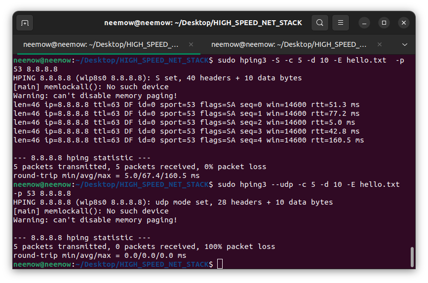

### 4.1 SYN scan: port open

The banner reports `S set, 40 headers + 5 data bytes` (20 IPv4 + 20 TCP + payload). The replies carry `flags=SA`, a **SYN-ACK**, which is the definition of an open TCP port. `hping3` never sends the final ACK, so the scan stays half-open. they arrive about one second apart, matching the probe interval, so they are best read as answers to the later probes and not as a fault.

### 4.2 UDP scan: no answer, inconclusive

The banner reports `28 headers + 5 data bytes` (20 IPv4 + 8 UDP). All five probes were sent and **none were answered**. A closed port would have returned an ICMP *port unreachable*, which `hping3` would have printed, so the result is **open|filtered**.

The silence is caused by the payload. `"HELLO"` is 5 bytes, shorter than the 12-byte DNS header, so the server cannot parse it as a query and drops it.

---

## 5. UDP scan with a valid DNS query

```bash
sudo hping3 --udp -c 5 -d 29 -E dns.bin -p 53 8.8.8.8
```

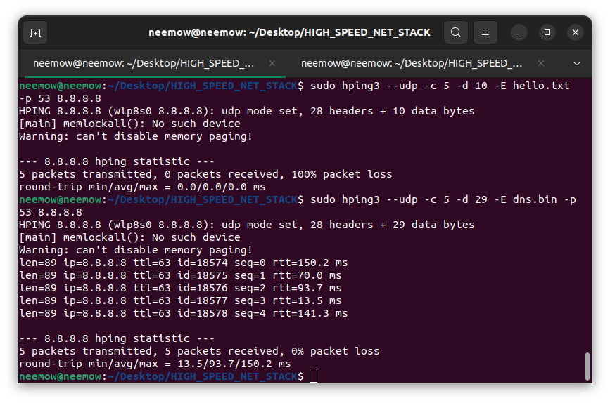

The banner reports `28 headers + 29 data bytes`, and this time the server answers. The replies show `len=89`: 20 bytes IPv4 + 8 bytes UDP + 61 bytes of DNS response (longer than the 29-byte query because the answer records are appended). A UDP reply from the scanned port is the one outcome that classifies a UDP port as definitively **open**.

Notes on `hping3`'s summary:

- **Packet loss.** Fewer replies than probes can be reported (4 of 5 in the run shown). UDP DNS is unreliable and a reply arriving after `hping3` exits is not counted, so one missing reply does not change the conclusion.
- **`DUP!` and RTT.** UDP replies carry no sequence number, so `hping3` credits them all to the first probe and flags the extras as duplicates. They are distinct packets with different IP identification values, not retransmissions. The RTT steps up by roughly one second per reply for the same reason, so only the first value is a meaningful round-trip time.
- **`-k` and `-s`.** During local testing against `nc -lu`, `-s 40000 -k` pinned the source port, because a UDP `nc` listener locks onto the first sender's address and port. Against `8.8.8.8` they are unnecessary: removing them gave the same results, so the commands above do not use them.

---

## 6. Summary of Part A

| Scan | Payload | Reply | Conclusion |
|---|---|---|---|
| TCP SYN to port 53 | `"HELLO"` (5 B) | SYN-ACK (`flags=SA`) | **open** |
| UDP to port 53 | `"HELLO"` (5 B) | none | open\|filtered (inconclusive) |
| UDP to port 53 | valid DNS query (29 B) | DNS response (`len=89`) | **open** |

Two points carry into Part B:

1. TCP gives a definite answer from the handshake alone. UDP's answer depends on whether the payload is meaningful to the service.
2. Every run printed `[main] memlockall(): No such device` and `Warning: can't disable memory paging!`. `hping3` tries to lock its memory in RAM for steadier timing and continues without it when the call fails. The warning does not affect the probes or the results.

---

# Part B — Tracing the scans with perf

## 7. Network-related tracepoints

The network tracepoints that actually produced samples in the capture were identified first:

| Event | Meaning |
|---|---|
| `net:net_dev_queue` | packet handed to the qdisc, before transmission |
| `net:net_dev_start_xmit` | driver hand-off (driver entry point) |
| `net:net_dev_xmit` | driver returned, with return code `rc` |
| `skb:consume_skb` / `skb:kfree_skb` | buffer released (normal path / drop path) |
| `net:napi_gro_receive_entry` / `_exit` | receive side |

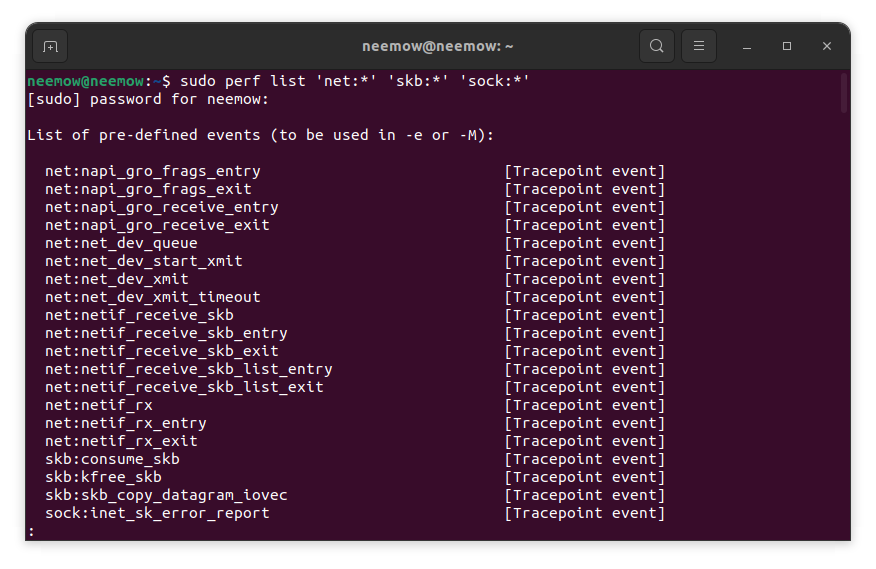

---

## 8. Recording the sessions

```bash
# system-wide capture, both scans
sudo perf record -a -e 'net:*,skb:*' --call-graph fp -o perf_syn.data -- \
     sudo hping3 -S -p 53 --data 100 8.8.8.8 -c 10

sudo perf record -a -e 'net:*,skb:*' --call-graph fp -o perf_udp.data -- \
     sudo hping3 --udp -p 53 --data 100 8.8.8.8 -c 10
```

The system-wide (`-a`) captures are large (SYN session: 6.031 MB, 17,851 samples) and dominated by background traffic: roughly 4,000 `napi_gro_receive` and 7,000 `skb:kfree_skb` samples, against only 40 events belonging to the ten probes. That noise makes per-packet attribution unreliable, so the measurement was repeated **task-scoped**, without `-a`:

```bash
sudo perf record -e 'net:*,skb:*' --call-graph fp -o perf_syn_clean.data -- \
     sudo hping3 -S -p 53 --data 100 8.8.8.8 -c 10
```

The same was done for UDP (`perf_udp_clean.data`). Each clean file contains exactly **40 samples = 10 packets × 4 events**, and `perf report --sort comm` attributes 100 % of them to `hping3`.

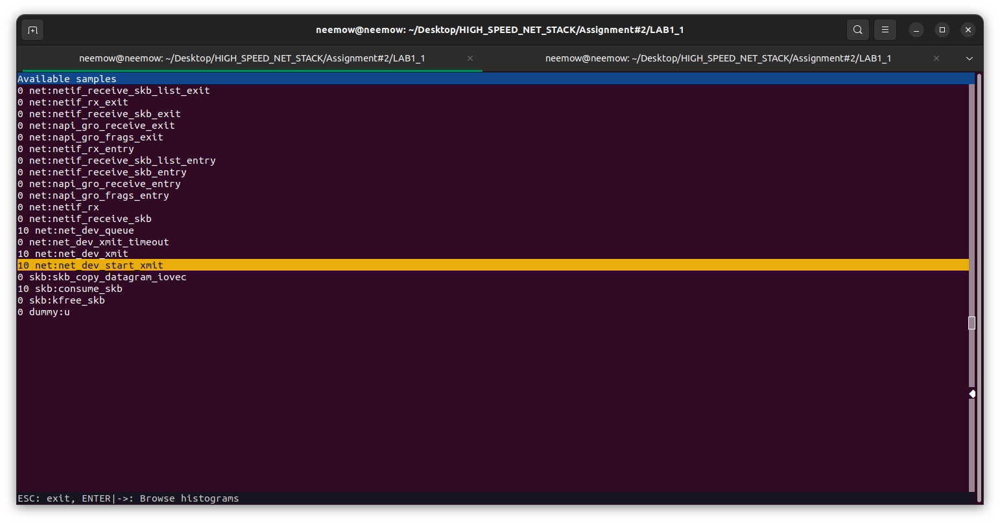

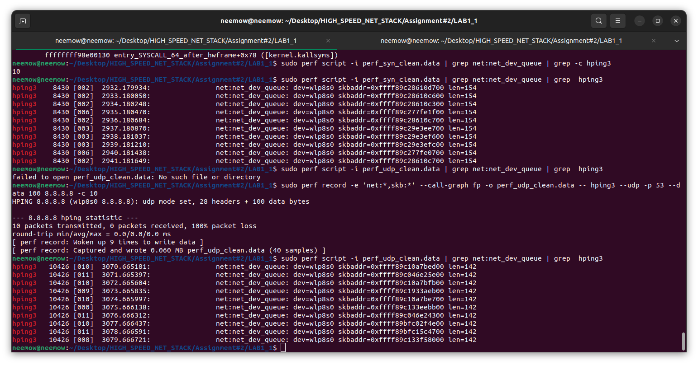

The two capture types are used for different purposes. The **clean** files are the basis of the transmit-side comparison. The **system-wide** files are the only place the receive side and the kernel's own reactions appear, because those run in softirq and not in `hping3`'s context.

---

## 9. Event selected for comparison: `net:net_dev_start_xmit`

Four events occur for every probe. `net:net_dev_start_xmit` was chosen because it is the **lowest layer both scans reach through identical code**, it fires in the scanning task's own context (so it survives task-scoped recording), and it exposes the most per packet: 14 fields covering L2 metadata, length, offsets and offload state.

```bash
sudo perf script -i perf_syn_clean.data | grep 'net:net_dev_start_xmit' | grep hping3 > syn_xmit.txt
sudo perf script -i perf_udp_clean.data | grep 'net:net_dev_start_xmit' | grep hping3 > udp_xmit.txt
```

A representative record from each scan:

```text
hping3 8430 [002] 2932.179944: net:net_dev_start_xmit: dev=wlp8s0 queue_mapping=0
  skbaddr=0xffff89c28610d700 vlan_tagged=0 vlan_proto=0x0000 vlan_tci=0x0000
  protocol=0x0800 ip_summed=0 len=154 data_len=0 network_offset=14
  transport_offset_valid=1 transport_offset=34 tx_flags=0 gso_size=0 gso_segs=0 gso_type=0

hping3 10426 [010] 3070.665198: net:net_dev_start_xmit: dev=wlp8s0 queue_mapping=0
  skbaddr=0xffff89c10a7bed00 vlan_tagged=0 vlan_proto=0x0000 vlan_tci=0x0000
  protocol=0x0800 ip_summed=0 len=142 data_len=0 network_offset=14
  transport_offset_valid=1 transport_offset=34 tx_flags=0 gso_size=0 gso_segs=0 gso_type=0
```

---

## 10. Result: the probes differ by twelve bytes

Stripping the volatile fields (process/CPU prefix, timestamp, `skbaddr`) and collapsing duplicates:

```bash
strip() { sed -E 's/^[^ ]+ +[0-9]+ +\[[0-9]+\] +[0-9]+\.[0-9]+: +//; s/skbaddr=0x[0-9a-f]+//g; s/\+0x[0-9a-f]+//g'; }
cat syn_xmit.txt | strip | sort | uniq -c
cat udp_xmit.txt | strip | sort | uniq -c
```

```text
=== SYN ===
     10 ... dev=wlp8s0 queue_mapping=0 vlan_tagged=0 vlan_proto=0x0000 vlan_tci=0x0000
            protocol=0x0800 ip_summed=0 len=154 data_len=0 network_offset=14
            transport_offset_valid=1 transport_offset=34 tx_flags=0 gso_size=0 gso_segs=0 gso_type=0
=== UDP ===
     10 ... dev=wlp8s0 queue_mapping=0 vlan_tagged=0 vlan_proto=0x0000 vlan_tci=0x0000
            protocol=0x0800 ip_summed=0 len=142 data_len=0 network_offset=14
            transport_offset_valid=1 transport_offset=34 tx_flags=0 gso_size=0 gso_segs=0 gso_type=0
```

Each scan collapses to **one distinct record with count 10**. Apart from the buffer address and timestamp, all ten packets of a scan are identical, and the two scans differ in exactly one field.

| | TCP SYN scan | UDP scan |
|---|---|---|
| Records in clean trace | 10 | 10 |
| Samples in file | 40 | 40 |
| `len` | **154** | **142** |
| `protocol` | `0x0800` | `0x0800` |
| `network_offset` / `transport_offset` | 14 / 34 | 14 / 34 |
| `data_len`, `gso_size`, `gso_segs`, `tx_flags`, `vlan_*` | all 0 | all 0 |
| `queue_mapping`, `dev` | 0, `wlp8s0` | 0, `wlp8s0` |
| Inter-probe interval | 1.000193 s (mean of 9 gaps) | 1.000171 s (mean of 9 gaps) |
| Replies seen by `hping3` | 10 × SYN-ACK | none |
| CPUs observed | 2, 6, 3 | 8–11, 0 |

The difference is pure header arithmetic:

$$154 = 14_{\text{Ethernet}} + 20_{\text{IPv4}} + 20_{\text{TCP}} + 100_{\text{payload}}$$
$$142 = 14_{\text{Ethernet}} + 20_{\text{IPv4}} + \ 8_{\text{UDP}} + 100_{\text{payload}}$$
$$\Delta = 20 - 8 = 12 \text{ bytes}$$

Two independent sources confirm it. `hping3`'s banner prints the userspace arithmetic (`40 headers + 100 data bytes` for SYN, `28 headers + 100 data bytes` for UDP); adding the 14-byte Ethernet header gives 154 and 142, matching `skb->len` exactly. And the tracepoint's `network_offset=14` and `transport_offset=34` show the transport header sits directly after IPv4 in both cases, so the offsets cannot differ.

One consequence: **this event cannot tell TCP from UDP.** `protocol=0x0800` is the IPv4 EtherType in both, and no transport field is exported. The 12-byte length is the only trace of the transport protocol in the event, which is why length is the right quantity to compare.

---

## 11. What is identical, and why

Every probe of both scans produces the same event order:

```text
net:net_dev_queue → skb:consume_skb → net:net_dev_start_xmit → net:net_dev_xmit (rc=0)
```

This is expected, because the kernel's transmit path is transport-agnostic. `hping3` builds the TCP or UDP header itself in userspace and passes a finished IP packet to the kernel through a raw socket, so the kernel never chooses between TCP and UDP for these packets. It only queues and transmits the frame (`dev_queue_xmit` → qdisc → `ndo_start_xmit`).

The `skb:consume_skb` event in this sequence is not the probe being released. Its `location` is `tpacket_rcv`, and its `skbaddr` differs from the probe's. It is the copy delivered to a packet-socket listener (`hping3`'s capture of its own traffic) being freed.

The one-second cadence is also protocol-independent: the 9 gaps average 1.000193 s (SYN) and 1.000171 s (UDP), with jitter well under a millisecond. That is `hping3`'s default `-i 1`, userspace software scheduling and not a network-driven rhythm.

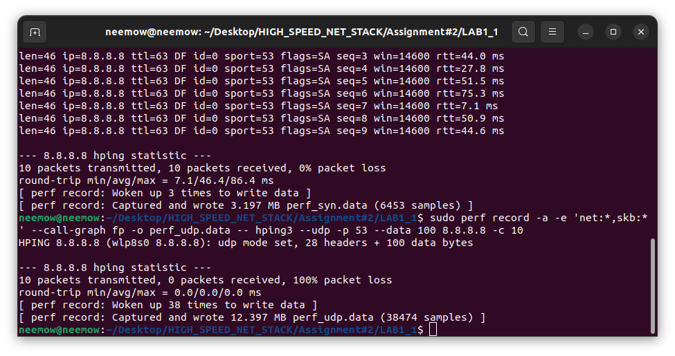

---

## 12. What the probe event cannot show: how the stack reacts

At the driver boundary the probes differ by only 12 bytes, yet the two scans are different operations. The difference lies in what the replies do.

### 12.1 UDP: no state, so silence or ICMP

UDP carries an 8-byte header and no state. A closed port yields an ICMP *port unreachable*; an open or filtered port yields silence. The UDP perf session used a 100-byte filler payload (not a DNS message), so it produced no replies, the classic *open|filtered* result. Part A (section 5) shows that a valid DNS query to the same port does get replies, so that silence reflects the payload and not a closed port.

The two behaviours can be reproduced locally. With nothing bound to the port the kernel returns ICMP; with a bound socket there is no ICMP:

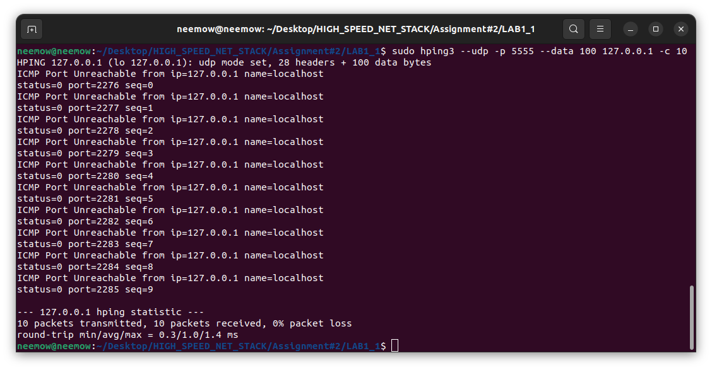

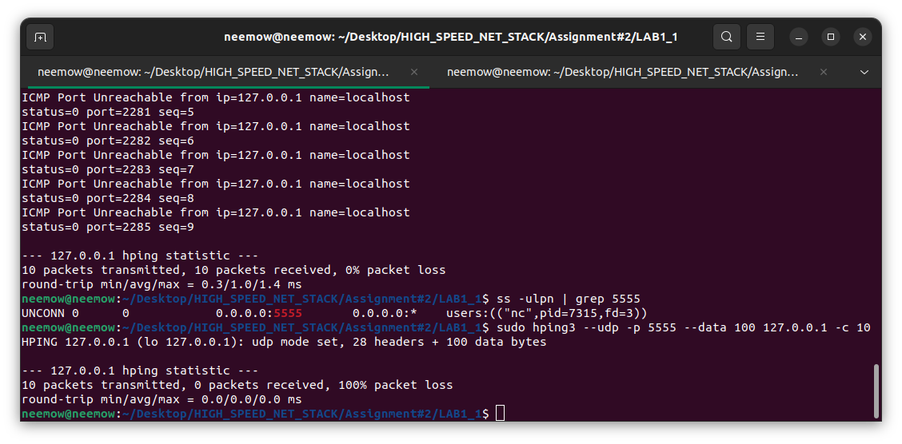

### 12.2 SYN: the kernel answers every SYN-ACK with an RST

The SYN scan carries a 20-byte TCP header and draws a SYN-ACK that the local kernel must handle. Filtering the system-wide captures for 54-byte transmissions at `net:net_dev_xmit` finds frames that `hping3` did not send:

```bash
perf script -G -i perf_syn.data | grep net_dev_xmit | grep 'len=54'
perf script -G -i perf_udp.data | grep net_dev_xmit | grep 'len=54'
```

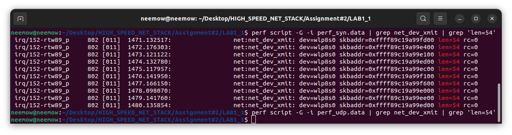

- **Ten in the SYN capture, none in the UDP capture.**
- **Not sent by `hping3`.** The process column reads `irq/152-rtw89_p`, the Wi-Fi driver's IRQ thread. The kernel transmitted them from the receive softirq.
- **54 bytes is a minimal TCP segment:** 14 Ethernet + 20 IPv4 + 20 TCP, no options, no payload. The probes were 154 and 142 bytes.
- **One per second**, matching the probe cadence, so one per SYN-ACK.

The resolved call stack identifies them (innermost frame first, offsets omitted):

```text
net:net_dev_xmit: dev=wlp8s0 ... len=54 rc=0
    dev_hard_start_xmit
    __dev_queue_xmit
    neigh_hh_output
    ip_finish_output2
    __ip_finish_output
    ip_finish_output
    ip_output
    ip_push_pending_frames
    ip_send_unicast_reply
    tcp_v4_send_reset            <-- the RST is built here
    tcp_v4_rcv                   <-- the SYN-ACK arrives at the TCP layer
    ip_protocol_deliver_rcu
    ip_local_deliver_finish
    ip_local_deliver
    ip_rcv
    __netif_receive_skb_core
    __netif_receive_skb_list_core
    netif_receive_skb_list_internal
    napi_complete_done
    rtw89_pci_napi_poll          <-- Wi-Fi driver NAPI poll
    __napi_poll
    net_rx_action
    handle_softirqs
    __do_softirq / do_softirq
    rtw89_pci_interrupt_threadfn
    irq_thread_fn / irq_thread / kthread
```

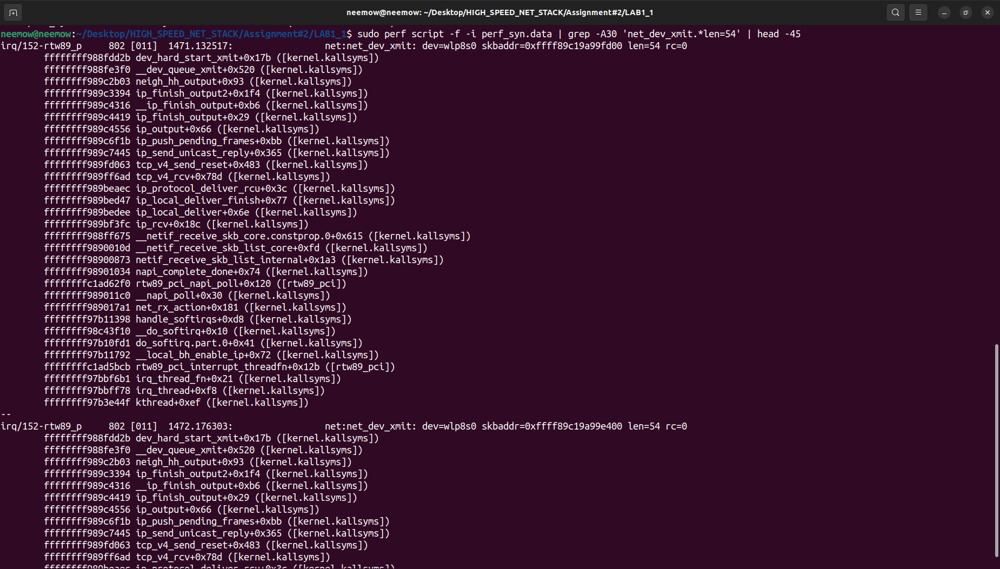

Read from the bottom up: the Wi-Fi interrupt thread polls the driver, a softirq pushes the received frame through `ip_rcv` and `ip_local_deliver` to `tcp_v4_rcv`, and TCP finds no socket for the segment. `tcp_v4_rcv` therefore calls `tcp_v4_send_reset`, which sends the reset back down through `ip_send_unicast_reply` and the output path to the driver. This is the kernel's standard reaction to a TCP segment that belongs to no connection. `hping3` crafts packets itself, so the kernel never created a socket for the half-open connection.

The SYN-ACK is therefore not silently dropped: it is delivered to the TCP layer and actively answered. This is also why a half-open scan leaves no state on the target, since the RST tells the server to abandon the connection.

The effect on the transmit side:

| `net:net_dev_xmit` frames | SYN scan | UDP scan |
|---|---|---|
| Sent by `hping3` (len 154 / 142) | 10 | 10 |
| Sent by the kernel (len 54, RST) | 10 | 0 |
| **Total transmitted** | **20** | **10** |

For the same number of probes, the SYN scan makes the local host transmit twice as many frames.

**Trade-off.** SYN buys certainty (three distinguishable outcomes) at the cost of a larger header, connection-state handling on the target and an extra RST from the local kernel. UDP is cheaper and quieter but cannot tell an open port from a filtered one.

---

## 13. Supplementary event, receive side: `net:napi_gro_receive_entry`

The primary comparison is `net:net_dev_start_xmit` (sections 9–10). As a supplement, the system-wide captures also record the receive path. `net:napi_gro_receive_entry` exports a frame length but no addresses or ports, so a filter on it can only match a *signature* of a SYN-ACK. The proof that these frames are TCP segments comes from the RST call stack in section 12.2.

The filter selects IPv4 frames (`protocol=0x0800`) of length 46 at the GRO entry point (a SYN-ACK with standard TCP options, after the Ethernet header has been consumed) that are not fragmented (`data_len=0`):

```bash
# Positive test — SYN capture
perf script -i perf_syn.data \
  | grep 'napi_gro_receive_entry' \
  | grep 'protocol=0x0800' \
  | grep 'len=46 ' \
  | grep 'data_len=0'

# Negative control — UDP capture
perf script -i perf_udp.data \
  | grep 'napi_gro_receive_entry' \
  | grep 'protocol=0x0800' \
  | grep 'len=46 ' \
  | grep 'data_len=0'
```

**SYN capture: 10 matching events**, one per probe, all in the wireless driver's IRQ thread `irq/152-rtw89_p`, so the SYN-ACKs are processed asynchronously on the receive path:

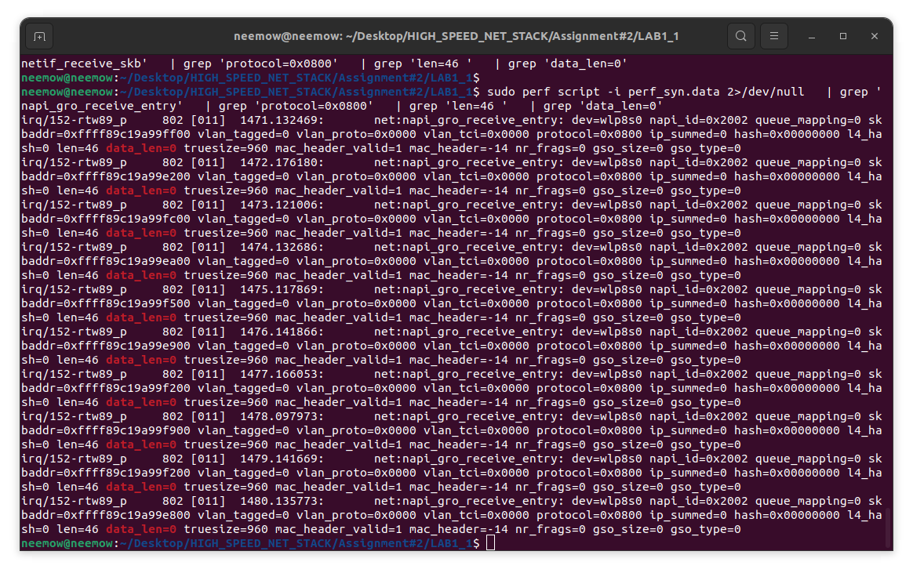

**UDP capture: 0 matching events.** A UDP scan with a filler payload produces no TCP-shaped reply, so there is no SYN-ACK for the GRO layer to handle:

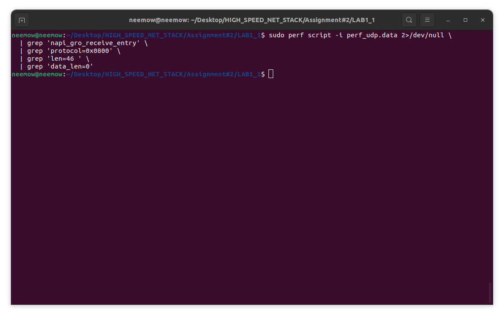

| | SYN capture (`perf_syn.data`) | UDP capture (`perf_udp.data`) |
|---|---|---|
| Matching `napi_gro_receive_entry` frames | **10** | **0** |
| `protocol` | `0x0800` | — |
| `len` at GRO entry | 46 | — |
| `data_len` | 0 | — |
| Processing context | `irq/152-rtw89_p` (driver IRQ thread) | — |

**Cross-check.** A size filter in a system-wide capture could in principle match unrelated 46-byte frames, so it is checked against an independent observation. The SYN capture contains ten GRO matches and ten kernel RSTs sent from `tcp_v4_rcv` in the same `irq/152-rtw89_p` thread. The counts agree one to one, and the stack proves each RST answers a TCP segment delivered by the receive path. The UDP capture has neither.

Each SYN probe therefore produces one outgoing probe event (section 10), one incoming event at the GRO layer and one outgoing RST (section 12.2). Each UDP probe produces one outgoing event and nothing else, which is the protocol-level definition of *open|filtered*.

---

## 14. Limitations

- The traces describe the **local host only**. What the destination does is inferred from `hping3`'s replies and ICMP messages.
- Task-scoped recording sees events only while `hping3` is on-CPU. Kernel-side reactions (received SYN-ACK, the kernel's RST, ICMP unreachable) run in softirq and are **absent from the clean files**; that side comes only from the system-wide captures.
- System-wide counts, such as the `kfree_skb` totals, include unrelated background traffic and cannot be attributed to the scan, so no conclusion rests on them. The receive-side findings rest on specific, attributable events: the ten RST transmissions and their call stacks.
- `len=54` and `len=46` are size signatures. The call stack (`tcp_v4_send_reset` called from `tcp_v4_rcv`) confirmed the RSTs inspected, but a size filter alone does not identify a frame.
- The perf capture of the UDP scan used a 100-byte filler payload, so the receive-side negative control in section 13 holds for that payload only. The DNS-query variant from Part A was run with `hping3` but not traced with `perf`.
- CPU migration during a run (SYN on CPUs 2/6/3, UDP on 8–11/0) is the scheduler moving a process that sleeps one second at a time. `perf report` aggregates per CPU and so splits the samples; `perf script` is the right level of analysis. It is not a property of the scan.

---

## 15. Conclusion

Part A showed that the two scans answer the same question differently. The SYN scan gets a SYN-ACK from the handshake alone. The UDP scan stays silent until the payload is a valid DNS query, at which point the server replies and the port is confirmed open.

Part B selected `net:net_dev_start_xmit`, which reduced each ten-packet scan to one repeated record and made the comparison exact rather than statistical. Four results follow:

1. Both scans traverse the **same four-event transmit path** in the same order. The transport protocol is decided in userspace, before the packet reaches the kernel's driver path.
2. The only difference between the probes at that boundary is **154 vs 142 bytes**, fully explained by TCP's 20-byte header against UDP's 8, with an identical 100-byte payload.
3. The **one-second pacing is set by `hping3`**, not by the kernel, with sub-millisecond jitter from userspace scheduling.
4. The SYN scan makes the **local kernel transmit ten extra frames**: a 54-byte RST for each SYN-ACK, built in `tcp_v4_send_reset` and sent from the receive softirq. The UDP scan produces none, so for the same ten probes SYN puts 20 frames on the wire and UDP 10.

The behavioural difference between the scan types (connection-state handling versus statelessness, RST versus ICMP, certainty versus silence) is invisible in the fields of the probe records themselves. It shows up in who transmits, in how many frames, and in the receive path, which demonstrates how far up the stack protocol semantics are decided.

---

## Appendix — SYN trace, all ten probes

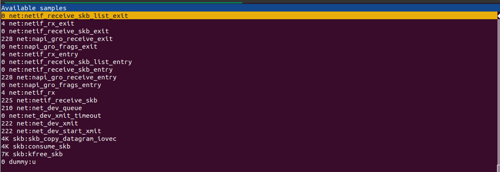

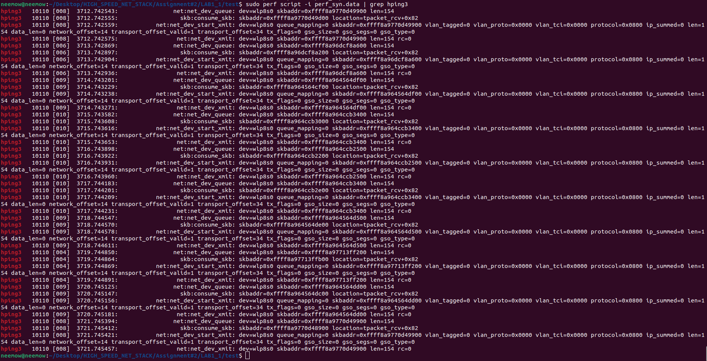
