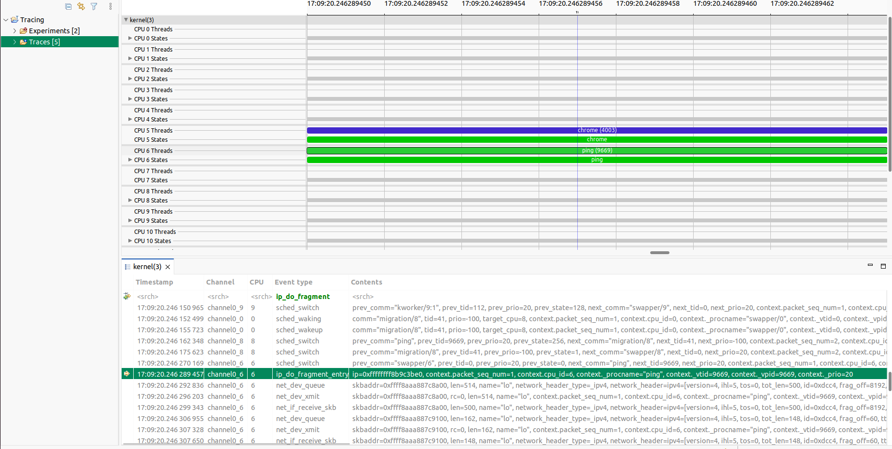
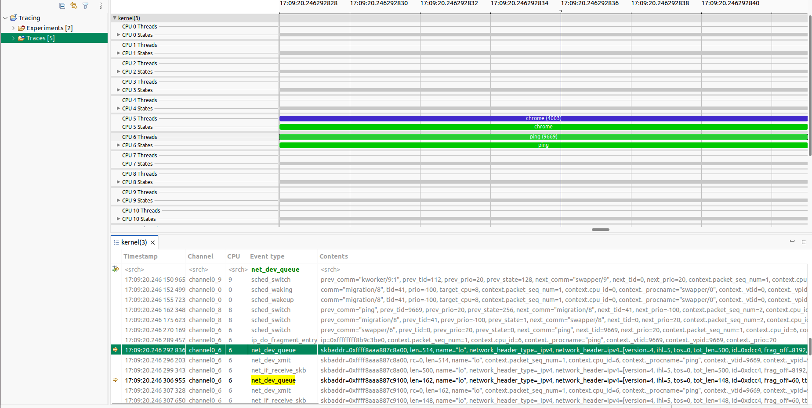

### LAB2 Report: IP Packet Fragmentation

### Setting up the loopback interface

To trigger IP fragmentation without relying on external hosts, I used the loopback interface (`lo`). Its default MTU is 65536 bytes, which is too large to cause fragmentation for a typical test payload, so I lowered it to 500 bytes:

```bash
sudo ip link set lo mtu 500
```

With a 500-byte MTU and a 600-byte ICMP payload, the kernel must split each datagram into at least two fragments before it can pass through the interface. One additional detail mattered here: `ping` sets the DF (Don't Fragment) bit by default. With DF set the kernel refuses to fragment and returns a "Frag needed" error instead. The `-M dont` flag clears DF and allows fragmentation to proceed normally.

### Triggering fragmentation with ping

I sent five ICMP echo requests with a 600-byte payload and DF cleared:

```bash
ping -M dont -c 5 -s 600 127.0.0.1
```

All five requests received replies. The `ping` output reports 608 bytes per reply, which is the 600-byte ICMP data plus the 8-byte ICMP header. This is the reassembled size after the kernel recombines the fragments on the receive path, so the number is expected.


### Verifying fragmentation via /proc/net/snmp

To confirm that the kernel fragmented and reassembled the packets rather than passing them through whole, I recorded the relevant IP counters from `/proc/net/snmp` before and after running the ping:

```bash
grep -E "^Ip:" /proc/net/snmp
```

The counters that changed are:

| Counter | Before | After | Delta |
|---|---|---|---|
| `FragOKs` | 60 | 70 | +10 |
| `FragCreates` | 120 | 140 | +20 |
| `ReasmReqds` | 110 | 130 | +20 |
| `ReasmOKs` | 55 | 65 | +10 |

Five echo requests and five replies produced ten outgoing datagrams in total. Each datagram was split into two fragments, so `FragCreates` rose by 20 and `FragOKs` (the count of successful fragmentation operations, one per original datagram) rose by 10. On the receive side, 20 incoming fragments were queued for reassembly (`ReasmReqds` +20), and all ten datagrams were reassembled successfully (`ReasmOKs` +10). The deltas are internally consistent and confirm that every datagram went through the kernel fragmentation path.

### Tracing fragmentation with LTTng

After confirming fragmentation with the IP statistics counters, I used LTTng to trace the relevant kernel networking activity. The goal was to observe calls to the IPv4 fragmentation routine and network-device events, then inspect the recorded packet lengths in TraceCompass.

#### Checking kernel tracing support

First, I checked which networking and socket-buffer events were available in the running kernel:

```bash
sudo lttng list -k | grep -E 'ip|skb|net'
```

The available events included:

- `net_dev_queue`: records packets queued for transmission by a network device.
- `net_dev_xmit`: records packets passed to the network device's transmit function.
- `net_if_receive_skb`: records packets received by the network stack.
- `skb_kfree`: records socket-buffer deallocation.

I also checked whether the kernel exposed the IPv4 fragmentation function:

```bash
sudo grep -w ip_do_fragment /proc/kallsyms
```

The symbol `ip_do_fragment` was present, so I could instrument it with an LTTng kprobe.

#### Why and how I added the kprobe

The function `ip_do_fragment` is part of the Linux IPv4 output path and is responsible for fragmenting an IPv4 datagram when it exceeds the outgoing interface's MTU. Tracing its entry provides direct evidence that the kernel entered the fragmentation routine.

I added a probe named `ip_do_fragment_entry` at the entry point of that function:

```bash
sudo lttng enable-event --kernel --probe=ip_do_fragment ip_do_fragment_entry
```

Here, `--probe=ip_do_fragment` tells LTTng to place a kernel probe at the `ip_do_fragment` symbol, while `ip_do_fragment_entry` is the event name that appears in the trace. This probe records that the function was reached; by itself, it does not capture the function arguments or packet length.

#### Creating and configuring the LTTng session

I created a kernel tracing session and directed its output to a dedicated directory:

```bash
sudo lttng create assignment2_fragmentation \
    --output="$HOME/lttng-traces/assignment2_fragmentation"
```

I enabled the available network and socket-buffer events:

```bash
sudo lttng enable-event --kernel net_dev_queue
sudo lttng enable-event --kernel net_dev_xmit
sudo lttng enable-event --kernel net_if_receive_skb
sudo lttng enable-event --kernel skb_kfree
```

I then enabled the kprobe described above and added process context information to the kernel channel. The context fields help identify the process and thread associated with each event:

```bash
sudo lttng add-context -k -t procname -t vtid -t vpid -t prio
```

The session configuration was checked with:

```bash
sudo lttng list assignment2_fragmentation
```

The output confirmed that all five event rules were enabled: `ip_do_fragment_entry`, `net_dev_queue`, `net_dev_xmit`, `net_if_receive_skb`, and `skb_kfree`.

#### Recording the fragmentation experiment

I started the trace:

```bash
sudo lttng start
```

With tracing active, I reduced the loopback MTU to 500 bytes and sent five ICMP echo requests, each carrying 600 bytes of data. The `-M dont` option allows fragmentation by clearing the Don't Fragment restriction:

```bash
sudo ip link set lo mtu 500
ping -M dont -c 5 -s 600 127.0.0.1
```

All five requests received replies. After the test, I stopped tracing and restored the loopback MTU:

```bash
sudo lttng stop
sudo ip link set lo mtu 65536
```

The session was then destroyed:

```bash
sudo lttng destroy assignment2_fragmentation
```

The trace was written to:

```text
/home/neemow/lttng-traces/assignment2_fragmentation
```

#### Verifying fragmentation in TraceCompass

I imported the LTTng trace into TraceCompass and inspected the Events view. The trace showed `ip_do_fragment_entry` followed by two consecutive `net_dev_queue` events. The event details exposed both the socket-buffer length (`len`) and the IPv4 header's total-length field (`network_header.ipv4.tot_len`).

The observed sequence was:

## **Observed fragmentation sequence**

1. `ip_do_fragment_entry`

   The kernel enters the IPv4 fragmentation function.

2. `net_dev_queue` — **Fragment 1**

   `len=514`, IPv4 `tot_len=500`

   **500-byte IPv4 fragment**

3. `net_dev_xmit`

   The first fragment reaches the transmit path.

4. `net_if_receive_skb`

   The first fragment enters the receive path.

5. `net_dev_queue` — **Fragment 2**

   `len=162`, IPv4 `tot_len=148`

   **148-byte IPv4 fragment**

The event timestamps place these events together in the packet-processing sequence: the fragmentation probe is followed by the queueing and transmission/receive events for the resulting fragments.



*Figure: `ip_do_fragment_entry` and the surrounding network events in TraceCompass.*



*Figure: The two `net_dev_queue` events, showing the IPv4 total lengths of 500 and 148 bytes.*

#### Why are `len` and `tot_len` different?

The event details show:

| Fragment | `len` | IPv4 `tot_len` |
|---|---:|---:|
| First | 514 bytes | 500 bytes |
| Second | 162 bytes | 148 bytes |

`len` is the length of the socket buffer (`skb`) reported by the network tracepoint. `tot_len` is the total length specified in the IPv4 header. They describe different lengths, so they do not have to be equal. In this trace, the `skb` length is 14 bytes greater than the IPv4 total length for each fragment.

For determining the IPv4 fragment sizes, I use **`network_header.ipv4.tot_len`**, because it directly reports the total length specified by each fragment's IPv4 header. The two observed IPv4 lengths, 500 and 148 bytes, match the expected fragment sizes for this experiment.

#### Determining the original transmitted message length

Yes. The original message length can be reconstructed from the fragment lengths shown in TraceCompass.

The two IPv4 fragments have total lengths of 500 and 148 bytes. Each fragment contains its own 20-byte IPv4 header. Therefore, to reconstruct the original IPv4 datagram, add the two fragment lengths and subtract one duplicated IPv4 header:

\[
L_{\mathrm{IPv4\ datagram}} = 500 + 148 - 20 = 628\ \mathrm{bytes}
\]

Thus, the original IPv4 datagram was **628 bytes** long.

The original IPv4 datagram contains a 20-byte IPv4 header and an ICMP message:

\[
L_{\mathrm{ICMP\ message}} = 628 - 20 = 608\ \mathrm{bytes}
\]

The ICMP message itself contains an 8-byte ICMP header and the 600-byte data payload specified by `ping -s 600`:

\[
L_{\mathrm{ICMP\ data}} = 608 - 8 = 600\ \mathrm{bytes}
\]

Therefore, the trace allows the original packet and message sizes to be determined:

- **Original IPv4 datagram:** 628 bytes
- **ICMP message (header + data):** 608 bytes
- **ICMP data payload:** 600 bytes

This agrees with the command used to generate the traffic:

```bash
ping -M dont -c 5 -s 600 127.0.0.1
```

The `net_dev_queue` event's `len` field should not be used directly to reconstruct the IPv4 datagram in this case. The IPv4 `tot_len` values provide the relevant fragment lengths.

#### Conclusion

The experiment triggered IPv4 fragmentation by lowering the loopback MTU to 500 bytes and sending 600-byte ICMP data payloads. The `/proc/net/snmp` counters confirmed successful fragmentation and reassembly. LTTng then recorded calls to the kernel's `ip_do_fragment` function, and TraceCompass showed the corresponding network events.

The two observed IPv4 fragment lengths were 500 and 148 bytes. From these values, the original IPv4 datagram length was reconstructed as 628 bytes, corresponding to a 608-byte ICMP message containing the 600-byte data payload. This demonstrates both the fragmentation process and how the original transmitted message length can be determined from the tracing events.
