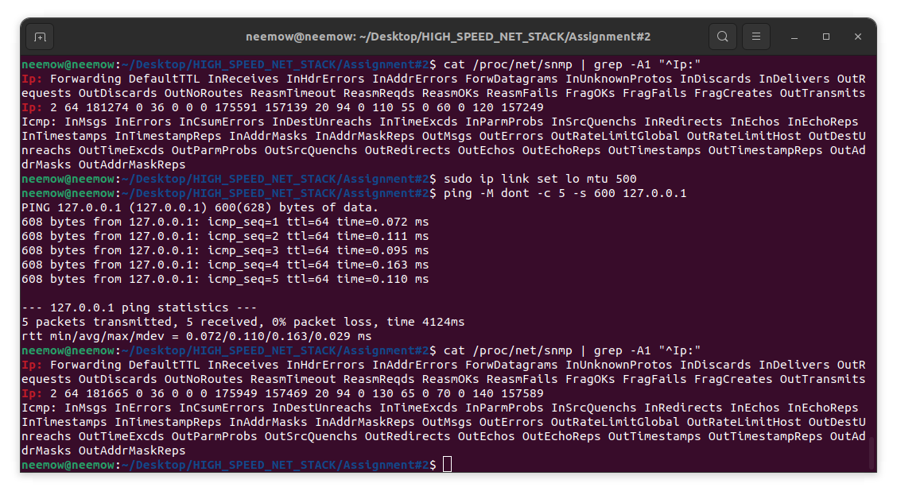

### LAB2 Report: IP Packet Fragmentation

### Setting up the loopback interface

To trigger IP fragmentation without relying on external hosts, I used the loopback interface (`lo`). Its default MTU is 65536 bytes, which is too large to cause fragmentation for a typical test payload, so I lowered it to 500 bytes:

```bash
sudo ip link set lo mtu 500
```

With a 500-byte MTU and a 600-byte ICMP payload, the kernel must split each datagram into at least two fragments before it can pass through the interface. One additional detail mattered here: `ping` sets the DF (Don't Fragment) bit by default. With DF set the kernel refuses to fragment and returns a "Frag needed" error instead. The `-M dont` flag clears DF and allows fragmentation to proceed normally.

### Triggering fragmentation with ping

I sent five ICMP echo requests with a 600-byte payload and DF cleared:

```bash
ping -M dont -c 5 -s 600 127.0.0.1
```

All five requests received replies. The `ping` output reports 608 bytes per reply, which is the 600-byte ICMP data plus the 8-byte ICMP header. This is the reassembled size after the kernel recombines the fragments on the receive path, so the number is expected.



### Verifying fragmentation via /proc/net/snmp

To confirm that the kernel fragmented and reassembled the packets rather than passing them through whole, I recorded the relevant IP counters from `/proc/net/snmp` before and after running the ping:

```bash
grep -E "^Ip:" /proc/net/snmp
```

The counters that changed are:

| Counter | Before | After | Delta |
|---|---|---|---|
| `FragOKs` | 60 | 70 | +10 |
| `FragCreates` | 120 | 140 | +20 |
| `ReasmReqds` | 110 | 130 | +20 |
| `ReasmOKs` | 55 | 65 | +10 |

Five echo requests and five replies produced ten outgoing datagrams in total. Each datagram was split into two fragments, so `FragCreates` rose by 20 and `FragOKs` (the count of successful fragmentation operations, one per original datagram) rose by 10. On the receive side, 20 incoming fragments were queued for reassembly (`ReasmReqds` +20), and all ten datagrams were reassembled successfully (`ReasmOKs` +10). The deltas are internally consistent and confirm that every datagram went through the kernel fragmentation path.

After the test I restored the loopback MTU:

```bash
sudo ip link set lo mtu 65536
```