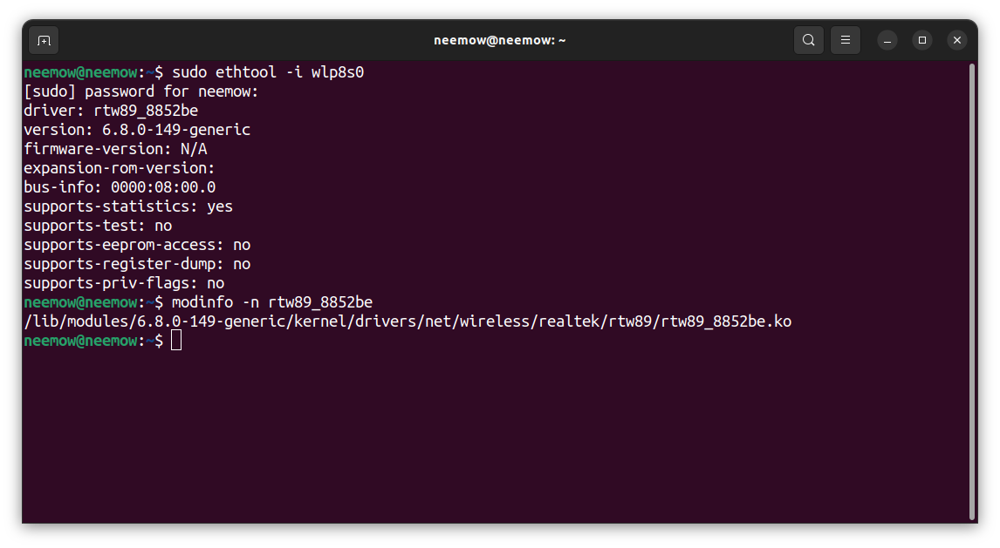

# Assignment 1 --- Understanding `struct net_device`

## 1. Introduction

`struct net_device` is the Linux kernel's common representation of a
network interface. It stores information needed by the networking
subsystem to manage the device, configure it, and exchange packets
through it.

This report examines the structure's main fields, the role of its
operations table (`netdev_ops`), and the packet-transmission path. I use
Linux source-code inspection and `ftrace` to identify and monitor the
nested functions involved in transmission.

## 2. Locating `struct net_device`

The definition of `struct net_device` is located in:

``` text
include/linux/netdevice.h
```

The structure is large, so it is more useful to understand its main
responsibilities than to describe every field individually.

## 3. Examining the structure

The fields in `struct net_device` can be understood in a few broad
groups. Examples of individual members include:

-   `name`: the network interface name.
-   `ifindex`: the interface index.
-   `mtu`: the maximum transmission unit.
-   `dev_addr`: the device's hardware address.
-   `flags`: interface flags describing its configuration and state.
-   `netdev_ops`: a pointer to the device's operations table.

-   **Device identity and configuration:** Includes the interface name,
    hardware address, interface type, MTU, and interface flags.
-   **Transmit and receive processing:** Holds pointers to transmit and
    receive queues, queue counts, and packet-processing configuration
    such as offload-related features.
-   **Networking subsystem integration:** Contains references to
    components used by protocols and features such as IPv4, IPv6, VLAN,
    wireless networking, and XDP.
-   **Statistics and operational state:** Stores device statistics and
    information about the interface's administrative and operational
    state.
-   **Lifecycle and synchronization:** Includes fields used for
    registration, reference management, locking, cleanup, and
    device-specific private data.

### 3.1 Cache-line organization

The definition also groups frequently accessed fields according to their
use in packet processing. The source identifies groups for:

-   `net_device_read_tx`: fields commonly read on the transmit path.
-   `net_device_read_txrx`: fields shared by transmit and receive
    processing.
-   `net_device_read_rx`: fields commonly read on the receive path.

This organization reflects the performance requirements of networking
code. Transmit and receive processing access device information
frequently, so arranging related fields with cache behavior in mind can
help reduce unnecessary cache-line contention and improve access
efficiency.

Overall, `struct net_device` is not merely an interface description. It
is a central object connecting the generic networking subsystem with
queues, protocol-specific components, device state, and driver-provided
operations.

## 4. Device operations: `netdev_ops`

Inside `struct net_device`, the following field points to the device's
operations table:

``` c
const struct net_device_ops *netdev_ops;
```

`struct net_device_ops` is a collection of function pointers (callbacks)
describing operations supported by a network device. The generic
networking subsystem uses these callbacks to request device-specific
behavior without needing to know the details of every driver.

The callbacks can be grouped by purpose:

  ------------------------------------------------------------------------
  Category                Example callbacks        Purpose
  ----------------------- ------------------------ -----------------------
  Device lifecycle        `ndo_init`,              Initialize, activate,
                          `ndo_uninit`,            stop, and clean up a
                          `ndo_open`, `ndo_stop`   device.

  Packet transmission     `ndo_start_xmit`,        Submit packets for
                          `ndo_select_queue`       transmission and select
                                                   a transmit queue.

  Receive configuration   `ndo_set_rx_mode`,       Configure receive
                          `ndo_change_rx_flags`    filtering and related
                                                   behavior.

  Device configuration    `ndo_set_mac_address`,   Change interface
                          `ndo_change_mtu`         properties such as the
                                                   MAC address and MTU.

  Statistics              `ndo_get_stats64`        Retrieve device
                                                   statistics.

  Advanced features       `ndo_setup_tc`,          Support features such
                          `ndo_bpf`,               as traffic control,
                          `ndo_xdp_xmit`           BPF, and XDP.
  ------------------------------------------------------------------------

The operations table contains additional callbacks for features such as
VLAN, bridging, SR-IOV, and hardware timestamping. Not every driver
implements every callback; the available operations depend on the device
and its driver.

One particularly important callback for this assignment is:

``` c
netdev_tx_t (*ndo_start_xmit)(struct sk_buff *skb,
                              struct net_device *dev);
```

It is the driver's packet-transmission callback. The `skb` argument
points to the packet being transmitted, while `dev` identifies the
network device responsible for the transmission.

The callback's return type, `netdev_tx_t`, describes the transmission
result. It is a type, not a function name. Likewise, `ndo_start_xmit` is
a member of the operations structure, not necessarily the name of an
independently traceable function. The actual function executed depends
on which function the driver assigns to this callback.

## 5. Following the packet-transmission path in the source code

Rather than starting from a function name, the investigation folloId the
references found while examining `struct net_device` and its operations
table. This section records that discovery process in the same order in
which it was performed.

### 5.1 Starting from `netdev_tx_t` and `ndo_start_xmit`

While examining `struct net_device`, I found its `netdev_ops` member:

```c
const struct net_device_ops *netdev_ops;
```

This led us to inspect `struct net_device_ops` in
`include/linux/netdevice.h`. Its packet-transmission callback is declared
as:

```c
netdev_tx_t (*ndo_start_xmit)(struct sk_buff *skb,
                              struct net_device *dev);
```

Here, `ndo_start_xmit` is a function-pointer member, and `netdev_tx_t`
is the function's return type. To understand where this callback is
actually invoked, I searched for `netdev_tx_t` in the same header file.
That search led to two `static inline` helper functions:
`__netdev_start_xmit()` and `netdev_start_xmit()`.

The first helper invokes the callback through the operations-table
pointer:

```c
static inline netdev_tx_t __netdev_start_xmit(
    const struct net_device_ops *ops,
    struct sk_buff *skb,
    struct net_device *dev,
    bool more)
{
    netdev_xmit_set_more(more);
    return ops->ndo_start_xmit(skb, dev);
}
```

The second helper obtains the operations table from the `net_device`
object and calls the first helper:

```c
static inline netdev_tx_t netdev_start_xmit(
    struct sk_buff *skb,
    struct net_device *dev,
    struct netdev_queue *txq,
    bool more)
{
    const struct net_device_ops *ops = dev->netdev_ops;
    netdev_tx_t rc;

    rc = __netdev_start_xmit(ops, skb, dev, more);

    if (rc == NETDEV_TX_OK)
        txq_trans_update(dev, txq);

    return rc;
}
```

This revealed the connection betIen `struct net_device` and the
transmission callback:

1. `dev->netdev_ops` provides a pointer to the device's operations table.
2. `netdev_start_xmit()` passes that table to `__netdev_start_xmit()`.
3. `__netdev_start_xmit()` calls `ops->ndo_start_xmit(skb, dev)`.
4. The callback's return value is passed back; if it is `NETDEV_TX_OK`,
   the transmit-queue timestamp is updated.

At this point, I knew how the callback was invoked, but not yet where
the generic networking code called `netdev_start_xmit()`.

### 5.2 Finding where `netdev_start_xmit()` is called

Next, I searched for `netdev_start_xmit` in the kernel source. The
relevant call was found in `net/core/dev.c`, inside `xmit_one()`:

```c
static int xmit_one(struct sk_buff *skb, struct net_device *dev,
                    struct netdev_queue *txq, bool more)
{
    unsigned int len;
    int rc;

    if (dev_nit_active_rcu(dev))
        dev_queue_xmit_nit(skb, dev);

    len = skb->len;
    trace_net_dev_start_xmit(skb, dev);
    rc = netdev_start_xmit(skb, dev, txq, more);
    trace_net_dev_xmit(skb, rc, dev, len);

    return rc;
}
```

The important line is:

```c
rc = netdev_start_xmit(skb, dev, txq, more);
```

This is the call site connecting the generic transmit path in
`net/core/dev.c` to the helpers found earlier in
`include/linux/netdevice.h`. `xmit_one()` also emits trace events before
and after the call, recording the start of transmission and its result.

### 5.3 Source-code path established from the two discoveries

Putting the findings from Sections 5.1 and 5.2 together gives the
following path:

```text
net/core/dev.c

xmit_one(skb, dev, txq, more)
    |
    | calls
    v
netdev_start_xmit(skb, dev, txq, more)
    |
    | obtains dev->netdev_ops
    v
__netdev_start_xmit(ops, skb, dev, more)
    |
    | invokes the function pointer
    v
ops->ndo_start_xmit(skb, dev)
    |
    v
Driver/framework-provided transmit callback
```

The first two functions were found by following the source references:
I started from the `ndo_start_xmit` declaration and its return type,
located the helper functions in `netdevice.h`, and then searched for
the call to `netdev_start_xmit()` to find `xmit_one()` in `dev.c`.
This is why `xmit_one()` was not an arbitrary starting point.

The actual callback implementation depends on the operations table
registered for the network device. The active wireless interface and
the runtime path observed for it are examined in Section 7.

### 5.4 Identifying the mac80211 callback implementation

To identify the concrete function assigned to the callback, I followed
the wireless transmit path into `net/mac80211/iface.c`. The
`ieee80211_dataif_ops` operations table assigns
`ieee80211_subif_start_xmit` to `.ndo_start_xmit`:

```c
static const struct net_device_ops ieee80211_dataif_ops = {
    .ndo_open            = ieee80211_open,
    .ndo_stop            = ieee80211_stop,
    .ndo_uninit          = ieee80211_uninit,
    .ndo_start_xmit      = ieee80211_subif_start_xmit,
    .ndo_set_rx_mode     = ieee80211_set_multicast_list,
    .ndo_set_mac_address = ieee80211_change_mac,
    .ndo_setup_tc        = ieee80211_netdev_setup_tc,
};
```

This confirms the connection between the callback declaration and the
runtime trace: mac80211 assigns `ieee80211_subif_start_xmit` to
`ndo_start_xmit`, and ftrace records that function beneath
`dev_hard_start_xmit()` during the wireless transmit path.

### 5.5 Implications for ftrace

The source-code investigation identifies the functions and callback
involved in the transmit path, but some of these names may not appear
as independent entries in ftrace.

In particular, `netdev_start_xmit()` and
`__netdev_start_xmit()` are declared `static inline`. The compiler may
inline them into their callers rather than emit separate executable
functions. `xmit_one()` was also not available as an independent
function-graph target in this build.

Therefore, the runtime experiment used an enclosing function that was
available to ftrace, `dev_hard_start_xmit()`. The reason for choosing
that function and the observed nested calls are explained in Section 7.

## 6. Key findings

The source-code investigation established the following:

1.  `struct net_device` is the common kernel representation of a network
    interface. It groups device configuration, queues, protocol
    integration, statistics, state, and lifecycle information.
2.  Its fields are organized partly around transmit and receive access
    patterns, including explicit cache-line groups.
3.  The `netdev_ops` member points to a table of callbacks through which
    generic networking code requests device-specific operations.
4.  `ndo_start_xmit` is the packet-transmission callback in that table.
    It is a structure member, not necessarily a standalone function
    symbol.
5.  In the inspected transmit path, `xmit_one()` calls
    `netdev_start_xmit()`.
6.  `netdev_start_xmit()` obtains `dev->netdev_ops` and passes it to
    `__netdev_start_xmit()`.
7.  `__netdev_start_xmit()` invokes the driver's callback through
    `ops->ndo_start_xmit(skb, dev)`.
8.  The active interface is `wlp8s0` using `rtw89_8852be`; the runtime graph shows the mac80211 callback `ieee80211_subif_start_xmit()` beneath `dev_hard_start_xmit()`.

## 7. Monitoring nested function calls related to `struct net_device`

### 7.1 Why `dev_hard_start_xmit()` was selected

The source-code investigation had already shown that `xmit_one()` calls
`netdev_start_xmit()`, which eventually invokes the callback stored in
`dev->netdev_ops`. The next step was to find a function that could serve
as the root of the runtime function-graph trace.

To understand the surrounding call hierarchy, I inspected
`dev_hard_start_xmit()` in `net/core/dev.c`. Its implementation contains
the call to `xmit_one()`:

```c
static int xmit_one(struct sk_buff *skb, struct net_device *dev,
                    struct netdev_queue *txq, bool more)
{
    unsigned int len;
    int rc;

    if (dev_nit_active_rcu(dev))
        dev_queue_xmit_nit(skb, dev);

    len = skb->len;
    trace_net_dev_start_xmit(skb, dev);
    rc = netdev_start_xmit(skb, dev, txq, more);
    trace_net_dev_xmit(skb, rc, dev, len);

    return rc;
}

struct sk_buff *dev_hard_start_xmit(struct sk_buff *first,
                                    struct net_device *dev,
                                    struct netdev_queue *txq,
                                    int *ret)
{
    struct sk_buff *skb = first;
    int rc = NETDEV_TX_OK;

    while (skb) {
        struct sk_buff *next = skb->next;

        skb_mark_not_on_list(skb);
        rc = xmit_one(skb, dev, txq, next != NULL);
        if (unlikely(!dev_xmit_complete(rc))) {
            skb->next = next;
            goto out;
        }

        skb = next;
        if (netif_tx_queue_stopped(txq) && skb) {
            rc = NETDEV_TX_BUSY;
            break;
        }
    }

out:
    *ret = rc;
    return skb;
}
```

This source code established the relationship I needed:
`dev_hard_start_xmit()` calls `xmit_one()` for each packet, and
`xmit_one()` calls `netdev_start_xmit()`. Therefore,
`dev_hard_start_xmit()` is an enclosing function above the transmit
callback path that I had folloId in Section 5.

I then checked which of these functions were available as ftrace
targets by searching `/sys/kernel/debug/tracing/available_filter_functions`.
`dev_hard_start_xmit` was listed, so it could be selected as the
function-graph root. The inline helpers and `xmit_one()` were not listed
as independent trace targets in this kernel build.

The choice was therefore based on both source-code structure and
traceability: the source shoId that `dev_hard_start_xmit()` encloses
the call to `xmit_one()`, and the ftrace function list confirmed that
`dev_hard_start_xmit()` could be traced.

### 7.2 Identifying the active network driver

The interface used for the experiment was `wlp8s0`. The driver information was obtained with `ethtool -i wlp8s0`; it reported `rtw89_8852be`. The installed module path was checked with `modinfo -n rtw89_8852be` and pointed to the rtw89 wireless driver module.



*The screenshot records the interface/driver identification used to choose the relevant runtime transmit path.*

The `ieee80211_dataif_ops` table in `net/mac80211/iface.c` assigns
`ieee80211_subif_start_xmit` to `.ndo_start_xmit`. The runtime graph
shows `ieee80211_subif_start_xmit [mac80211]` directly under
`dev_hard_start_xmit()`, matching this source-code assignment. The trace also contains `rtw89_ops_wake_tx_queue [rtw89_core]`, called from the mac80211 transmit/queueing path. This rtw89 callback is evidence of interaction with the hardware driver, but it should not be described as the `ndo_start_xmit` callback itself: it is a queue-wakeup operation.

### 7.3 How the source path and runtime graph fit together

The two views complement each other:

1. **Source-code view:** `dev_hard_start_xmit()` processes the packet and calls `xmit_one()`; `xmit_one()` calls `netdev_start_xmit()`; `netdev_start_xmit()` reads `dev->netdev_ops`; `__netdev_start_xmit()` invokes `ops->ndo_start_xmit(skb, dev)`.
2. **Runtime view:** ftrace records `dev_hard_start_xmit()` folloId by `ieee80211_subif_start_xmit [mac80211]()` and its nested functions.
3. **Why intermediate names are missing:** the helper functions are inline and do not necessarily have independent function-graph entries. Their absence does not mean the callback path was skipped. The callback is reached through the function pointer, and the runtime trace shows the concrete mac80211 function that executes.

The observed high-level call chain is therefore:

```text
dev_hard_start_xmit()                 [generic networking]
  └─ xmit_one()                       [source-level helper; not separately shown]
      └─ netdev_start_xmit()          [inline helper; not separately shown]
          └─ __netdev_start_xmit()    [inline helper; not separately shown]
              └─ dev->netdev_ops->ndo_start_xmit(...)
                  └─ ieee80211_subif_start_xmit() [mac80211; observed]
                      └─ __ieee80211_subif_start_xmit()
                          └─ wireless packet preparation / queueing
                              └─ rtw89_ops_wake_tx_queue() [rtw89; observed]
```

This is the central connection to the assignment: `struct net_device` contains `netdev_ops`; the generic transmit path obtains that table from the device and calls its `ndo_start_xmit` function pointer. By tracing the enclosing generic transmit function, I observed the concrete nested implementation and subsequent mac80211/rtw89 calls.

### 7.4 Commands used during the investigation

The following commands summarize the source navigation, driver identification, ftrace symbol checks, and trace inspection performed so far. Run source searches from the root of the Linux kernel source tree.

**Follow the source references in the order used during the investigation:**

```bash
# 1. Inspect struct net_device and locate its netdev_ops member
grep -n -A20 -B10 "netdev_ops" include/linux/netdevice.h

# 2. Inspect the net_device_ops callback declaration and its return type
grep -n -A15 -B5 "ndo_start_xmit" include/linux/netdevice.h

# 3. Search the same header for netdev_tx_t to find the inline helpers
grep -n -A25 -B5 "netdev_tx_t" include/linux/netdevice.h

# 4. Search for the helper's call site in the generic networking code
grep -n -A25 -B5 "netdev_start_xmit" net/core/dev.c

# 5. Inspect xmit_one() and dev_hard_start_xmit() together
grep -n -A65 -B5 "static int xmit_one" net/core/dev.c

# 6. Find the mac80211 operations table and its ndo_start_xmit assignment
grep -n -A12 -B3 "ieee80211_dataif_ops" net/mac80211/iface.c

# 7. Check which relevant functions are available as ftrace targets
sudo grep -wE 'dev_hard_start_xmit|xmit_one|netdev_start_xmit|ieee80211_subif_start_xmit' \\
    /sys/kernel/debug/tracing/available_filter_functions
```

**Identify the active interface and its driver:**

```bash
ethtool -i wlp8s0
modinfo -n rtw89_8852be

# The rtw89 directory was also searched for direct net_device_ops assignments.
grep -R -n -E "ndo_start_xmit|net_device_ops" drivers/net/wireless/realtek/rtw89/
```

The availability check showed that `dev_hard_start_xmit` was
listed as a traceable function, while `xmit_one()` and the inline helper
names were not listed as independent targets in this kernel build.

**Configure and capture a function-graph trace:**

```bash
sudo mount -t debugfs none /sys/kernel/debug 2>/dev/null || true
cd /sys/kernel/debug/tracing

# Select the function-graph tracer and restrict the graph to the enclosing TX function
 echo function_graph | sudo tee current_tracer
 echo dev_hard_start_xmit | sudo tee set_graph_function

# Clear old events, start tracing, generate ordinary network traffic, then stop
 echo | sudo tee trace
 echo 1 | sudo tee tracing_on
# Generate traffic now (for example, use the network normally or ping a reachable host)
 echo 0 | sudo tee tracing_on

# Read the captured nested call graph
sudo less -N trace
```

If debugfs is already mounted, the mount command may report that it is busy; that is harmless. The traffic-generation step must occur betIen enabling and disabling tracing. The graph is limited to calls made under `dev_hard_start_xmit()` by `set_graph_function`.

**Inspect the trace and search for the target function:**

```bash
sudo cat /sys/kernel/debug/tracing/trace | less
# or, with line numbers:
sudo less -N /sys/kernel/debug/tracing/trace
```

Inside `less`, use `/dev_hard_start_xmit` to search, `n` for the next match, `N` for the previous match, and `q` to quit. The indentation and opening/closing braces in function-graph output represent nested calls and returns.

### 7.5 Observed nested function graph

The following is the relevant function-graph excerpt captured during the experiment. Durations are the values reported by ftrace for this particular run; they are not fixed costs and will vary with system load, CPU frequency, and packet/driver state.

```text
 0)               |  dev_hard_start_xmit() {
 0)               |    ieee80211_subif_start_xmit [mac80211]() {
 0)               |      __ieee80211_subif_start_xmit [mac80211]() {
 0)   0.959 us    |        __rcu_read_lock();
 0)               |        ieee80211_lookup_ra_sta [mac80211]() {
 0)               |          sta_info_get [mac80211]() {
 0)   0.787 us    |            __rcu_read_lock();
 0)   0.779 us    |            __rcu_read_unlock();
 0)   5.325 us    |          }
 0)               |          sta_info_get [mac80211]() {
 0)   0.573 us    |            __rcu_read_lock();
 0)   0.766 us    |            __rcu_read_unlock();
 0)   3.609 us    |          }
 0) + 11.210 us   |        }
 0)               |        ieee80211_select_queue [mac80211]() {
 0)   0.950 us    |          cfg80211_classify8021d [cfg80211]();
 0)   1.271 us    |          ieee80211_downgrade_queue [mac80211]();
 0)   4.755 us    |        }
 0)   1.024 us    |        ieee80211_aggr_check [mac80211]();
 0)               |        ieee80211_xmit_fast [mac80211]() {
 0)   0.770 us    |          ieee80211_tx_skb_fixup [mac80211]();
 0)               |          __ieee80211_xmit_fast [mac80211]() {
 0)               |            ieee80211_amsdu_aggregate [mac80211]() {
 0)   0.618 us    |              _raw_spin_lock_bh();
 0)               |              _raw_spin_unlock_bh() {
 0)   0.769 us    |                __local_bh_enable_ip();
 0)   2.176 us    |              }
 0)   5.993 us    |            }
 0)   0.795 us    |            ieee80211_skb_resize [mac80211]();
 0)   0.769 us    |            skb_push();
 0)               |            ieee80211_queue_skb [mac80211]() {
 0)   0.815 us    |              ktime_get();
 0)   0.804 us    |              _raw_spin_lock_bh();
 0)   1.100 us    |              fq_tin_enqueue.constprop.0 [mac80211]();
 0)               |              _raw_spin_unlock_bh() {
 0)   0.692 us    |                __local_bh_enable_ip();
 0)   2.067 us    |              }
 0)               |              __ieee80211_schedule_txq [mac80211]() {
 0)   0.674 us    |                _raw_spin_lock_bh();
 0)               |                _raw_spin_unlock_bh() {
 0)   0.660 us    |                  __local_bh_enable_ip();
 0)   1.861 us    |                }
 0)   4.306 us    |              }
 0)               |              rtw89_ops_wake_tx_queue [rtw89_core]() {
 0)               |                __ieee80211_schedule_txq [mac80211]() {
 0)   0.584 us    |                  _raw_spin_lock_bh();
 0)               |                  _raw_spin_unlock_bh() {
 0)   0.497 us    |                    __local_bh_enable_ip();
 0)   1.590 us    |                  }
 0)   3.918 us    |                }
 0)               |                queue_work_on() {
 0)               |                  __queue_work() {
 0)   0.703 us    |                    __rcu_read_lock();
 0)               |                    __queue_work.part.0() {
 0)   1.166 us    |                      wq_select_unbound_cpu();
 0)   1.340 us    |                      _raw_spin_lock();
 0)               |                      kick_pool() {
 0)               |                        wake_up_process() {
 0)               |                          try_to_wake_up() {
 0)   0.990 us    |                            _raw_spin_lock_irqsave();
 0)               |                            select_task_rq_fair() {
 0)   0.826 us    |                              __rcu_read_lock();
 0)               |                              wake_affine() {
 0)   0.853 us    |                                available_idle_cpu();
 0)   0.817 us    |                                available_idle_cpu();
 0)   3.888 us    |                              }
 0)               |                              select_idle_sibling() {
 0)   0.807 us    |                                available_idle_cpu();
 0)   2.213 us    |                              }
 0)   0.729 us    |                              __rcu_read_unlock();
 0) + 14.505 us   |                            }
 0)   1.483 us    |                            kthread_is_per_cpu();
 0)               |                            ttwu_queue_wakelist() {
 0)               |                              __smp_call_single_queue() {
 0)   1.221 us    |                                call_function_single_prep_ipi();
 0)   3.008 us    |                              }
 0)   4.733 us    |                            }
 0)   0.733 us    |                            _raw_spin_unlock_irqrestore();
 0) + 27.676 us   |                          }
 0) + 29.005 us   |                        }
 0) + 31.538 us   |                      }
 0)   0.565 us    |                      _raw_spin_unlock();
 0)   0.640 us    |                      __rcu_read_unlock();
 0) + 41.982 us   |                    }
 0) + 45.113 us   |                  }
 0) + 46.642 us   |                }
 0) + 52.875 us   |              }
 0) + 67.385 us   |            }
 0) + 79.057 us   |          }
 0) + 83.564 us   |        }
 0)   0.587 us    |        __rcu_read_unlock();
 0) ! 116.256 us  |      }
 0) ! 117.874 us  |    }
 0) ! 122.116 us  |  }
```

### 7.6 Interpretation of the observed calls

- `dev_hard_start_xmit()` is the generic networking transmit function selected as the graph root.
- `ieee80211_subif_start_xmit()` and `__ieee80211_subif_start_xmit()` are the mac80211 transmit path reached for the wireless interface. This is the concrete runtime evidence that connects the generic `net_device` transmit path to the wireless implementation.
- `ieee80211_lookup_ra_sta()` and `sta_info_get()` look up the destination station information needed by the wireless transmit path.
- `ieee80211_select_queue()` classifies the packet and selects an appropriate wireless transmit queue; the nested cfg80211 classification and queue-downgrade functions support that decision.
- `ieee80211_xmit_fast()` / `__ieee80211_xmit_fast()` perform the fast-path wireless packet handling. The graph shows aggregation, skb adjustment, and enqueue operations below them.
- `ieee80211_queue_skb()` queues the packet. `__ieee80211_schedule_txq()` and `rtw89_ops_wake_tx_queue()` show the handoff into the driver-specific queue scheduling/wakeup path.
- The nested `queue_work_on()`, `wake_up_process()`, and scheduler functions show deferred work being queued and a worker being woken. They are nested runtime consequences of the driver queue-wakeup path, rather than direct members of `struct net_device`.
- RCU and spinlock functions provide synchronization around shared networking/queue data. Their presence is expected in concurrent kernel paths.

The graph is not a list of functions that are all fields of `struct net_device`. Rather, it is the runtime call tree reached through the device's transmit operation. This distinction is important to interpreting the assignment accurately.

### 7.7 Trace scope and limitations

The trace demonstrates one observed wireless transmit execution. It does not prove that every packet follows exactly the same path: fast-path decisions, aggregation, queue state, packet type, and driver behavior can change the call graph. The scheduler and workqueue calls are included because they were nested under the selected root in this capture. Other unrelated functions elsewhere in the trace are outside the relevant excerpt.

The `!` marker and total durations in the supplied excerpt are ftrace formatting for the function-graph timing result; the reported values are specific to this capture. They should not be generalized as fixed per-packet latency.

## 8. Conclusion

`struct net_device` is the central object through which the generic Linux networking subsystem represents and operates a network interface. Its `netdev_ops` member provides the function-pointer interface that connects generic packet processing to a concrete device implementation.

The source inspection established the transmit callback path, and the ftrace experiment folloId that path at runtime. Starting at `dev_hard_start_xmit()`, the trace shoId the mac80211 transmit callback and its nested station lookup, queue selection, fast transmit, packet queueing, and rtw89 queue-wakeup operations. This directly addresses the assignment requirement to **monitor nested function calls related to `struct net_device`**: the monitored functions are related through the network device's transmit operation, not because every function is itself a member of the structure.

The experiment is one runtime sample for the `wlp8s0` wireless interface. Further experiments could narrow the graph or compare other packet paths, but the captured trace is sufficient to demonstrate the requested nested transmit call path.
